# Operational and Business Execution Playbook
## YM Inc. Retail Fleet Infrastructure & Telecom Deployment Suite

**Document Identifier:** `YM-PLAYBOOK-M4-2026-V1`  
**Milestone:** M4 — Operational and Business Playbook  
**Target File:** `docs/M4_OPERATIONAL_AND_BUSINESS_PLAYBOOK.md`  
**Author:** YM Inc. Retail Operations, IT Infrastructure & Construction Governance Team  
**Date:** October 2026  
**Status:** Approved Enterprise Operational Architecture & Governance Blueprint  
**Scope:** 376 Retail Stores across 13 Commercial Apparel Banners in Canada and the United States  
**Target Systems:** .NET 10 WPF Desktop Application, Next.js 15 Corporate SaaS Management Portal, Neon Serverless PostgreSQL, Fluke Networks LinkWare, Cisco Meraki Dashboard, Cradlepoint NetCloud  

---

## Document Index & Table of Contents

1. [Executive Summary & Operational Governance Charter](#1-executive-summary--operational-governance-charter)
   - 1.1 Enterprise Context: 376 Stores Across 13 Apparel Banners
   - 1.2 Core Operational Mission & Deployment Velocity Objectives
   - 1.3 Financial Penalty Exposure Analysis & Landlord Liability Modeling
   - 1.4 Architectural Alignment Across Milestones M1, M2, M3, and M4
2. [Landlord Compliance & Penalty Avoidance Framework](#2-landlord-compliance--penalty-avoidance-framework)
   - 2.1 Proactive Automated COI Renewal & Underwriting Workflow
   - 2.2 Statutory Insurance Threshold Audits & Endorsement Standards
   - 2.3 Automated OCR & Document Ingestion Pipeline
   - 2.4 Mall Operational Governance & Constraints
   - 2.5 Commercial Landlord Escalation Directory & REIT Specifications
3. [Comprehensive Landlord Compliance Risk Register & End-to-End Workflow Diagrams](#3-comprehensive-landlord-compliance-risk-register--end-to-end-workflow-diagrams)
   - 3.1 Landlord Compliance Risk Register (RSK-LND-001 through RSK-LND-012)
   - 3.2 End-to-End Compliance Lifecycle Workflow (Mermaid Architecture)
   - 3.3 End-to-End Compliance Lifecycle Workflow (ASCII Architecture)
   - 3.4 Relational Database Schema & Data Models (Neon PostgreSQL DDL)
   - 3.5 Cloud API Gateway Compliance Contracts
4. [Field Contractor Coordination & Milestone Governance](#4-field-contractor-coordination--milestone-governance)
   - 4.1 Mandatory Pre-Dispatch Site Readiness Checklists
   - 4.2 Photographic & Digital Sign-Off Gates for Invoice Approval
   - 4.3 Standard Operating Procedures (SOPs) for Field Governance
       - SOP-CTR-01: Delay Management, Access Obstructions & Standby Billing Protocols
       - SOP-CTR-02: Liquidated Damages, Re-Work Penalties & SLA Enforcement
       - SOP-CTR-03: Emergency Trade Rescheduling, Default Notices & Secondary Trade Dispatch
5. [Contractor Milestone Verification Criteria & Vendor SLA Scorecard Template](#5-contractor-milestone-verification-criteria--vendor-sla-scorecard-template)
   - 5.1 Step-by-Step 5-Phase Milestone Verification Criteria (ART-P1-01 through ART-P5-07)
   - 5.2 Multi-Dimensional Quantitative SLA Scoring Model
   - 5.3 Mathematical Scoring Algorithm & Quarterly Tiering Matrix
   - 5.4 Production Vendor SLA Scorecard Template
6. [Internal Retail Fleet Implementation & Daily Operations Manual](#6-internal-retail-fleet-implementation--daily-operations-manual)
   - 6.1 Enterprise Role Taxonomy & Accountability Framework
   - 6.2 Complete 42-Task Lifecycle RACI Matrix (Stages 1 through 5)
   - 6.3 08:30 EST Daily Standup Agenda & Central Blockers Board
   - 6.4 Weekly Regional Deployment Progression Cadence (T-8 Weeks to T+1 Week)
   - 6.5 NRF 4-5-4 Retail Fiscal Calendar Synchronization & Mandatory Deployment Freezes
7. [Rapid Incident Response Playbook & Phased Internal Rollout Schedule](#7-rapid-incident-response-playbook--phased-internal-rollout-schedule)
   - 7.1 Incident Severity Definitions & Response SLAs (P1 through P3)
   - 7.1.1 Two-Tier Emergency Incident & Blackout Recovery Architecture
   - 7.2 2-Hour Virtual War Room Activation & Senior Leadership Escalation Tree
   - 7.3 Rapid Tactical Countermeasure Playbooks (Playbooks 1 through 4)
   - 7.4 Fleet Composition & 3-Tier Banner Matrix
   - 7.5 Regional Deployment Clusters & Specialist Territories (PS1 through PS4)
   - 7.6 Resource Leveling & Corridor Sweep Routing Model
   - 7.7 Phased 4-Wave Rollout Timeline Across NRF Fiscal Calendar
   - 7.8 Governance Sign-Off & Implementation Roadmap

---

## 1. Executive Summary & Operational Governance Charter

### 1.1 Enterprise Context: 376 Stores Across 13 Apparel Banners
YM Inc. is one of North America's premier privately held retail fashion conglomerates, operating **376 brick-and-mortar retail stores across 13 commercial banners** throughout Canada and the United States. Its brand portfolio encompasses large-format family apparel flagships, youth streetwear, mall-based denim specialty shops, contemporary women's fashion, and value-tier retail chains:

- **Tier 1 Flagship & High-Volume Banners (158 Stores):** Urban Planet (78 stores, 12,000–25,000 sq ft), Bluenotes (55 stores, 4,500–7,000 sq ft), West 49 (25 stores, 3,500–5,500 sq ft).
- **Tier 2 Specialty Banners (112 Stores):** Suzy Shier (42 stores), Sirens (38 stores), Le Château (12 stores), Forever 21 (8 stores), Urban Kids (8 stores), Stitches / Urban Behavior / Other (4 stores).
- **Tier 3 Value & US Fleet Chains (106 Stores):** Charlotte Russe (52 stores), rue21 (44 stores), Mandee (10 stores).

Physical retail locations are situated within Tier-1 regional shopping centers, enclosed super-regional malls, open-air power centers, and commercial urban streetfront properties. The properties are governed by North America’s largest institutional real estate investment trusts (REITs) and asset management corporations, including **Cadillac Fairview Corporation, Oxford Properties Group, Ivanhoé Cambridge, RioCan REIT, Brookfield Properties, and Simon Property Group**.

### 1.2 Core Operational Mission & Deployment Velocity Objectives
The core mission of the YM Inc. Store Deployment & Telecom Management platform is to orchestrate, execute, and govern all physical technology infrastructure rollouts across this distributed footprint. This includes new store openings (NSOs), major architectural renovations, leasehold relocations, Cat6 structured cabling replacements, dual-channel power pole installations, optical fiber demarc extensions, edge routing migrations (Cisco Meraki MX68 + Cradlepoint 5G failover), and Veras POS hardware commissioning.

The operational objectives are bounded by strict velocity and reliability service level agreements (SLAs):
1. **On-Time Grand Opening Velocity:** $\ge 98.0\%$ of all scheduled store openings must execute on the exact contract baseline opening date without retail trade interruption.
2. **Zero Unbudgeted Landlord Infractions:** 100% elimination of landlord stop-work orders, daytime acoustic noise violations, freight dock impoundments, and unauthorized occupancy fines.
3. **First-Time-Right (FTR) Field Quality:** $\ge 97.0\%$ of structured cabling and electrical installations must pass primary inspection on initial audit, maintaining re-work rates below $3.0\%$.
4. **100% Cryptographic Artifact Gating:** Complete elimination of unverified contractor payments by enforcing automated digital proof gates (Fluke `.FLW` datasets, GPS-stamped visual proof, and ICMP telemetry) prior to Accounts Payable invoice release.
5. **Peak Revenue Protection:** Absolute enforcement of retail deployment freezes during high-volume trading periods defined by the National Retail Federation (NRF) 4-5-4 retail calendar.

### 1.3 Financial Penalty Exposure Analysis & Landlord Liability Modeling
Capital retail construction in institutional commercial properties operates under high-liability commercial lease agreements. Historical deployment workflows that relied on manual email communication, paper sign-off sheets, and uncoordinated trade scheduling generated severe financial bleeding. 

The financial exposure per incident category is modeled below:

```
+========================================================================================================+
 financial penalty exposure & liability matrix
+-----------------------------------+-----------------------+--------------------+-----------------------+
| Infraction / Operational Failure  | Unit Cost Exposure    | Frequency / Fleet  | Annual Financial Risk |
+-----------------------------------+-----------------------+--------------------+-----------------------+
| Landlord Stop-Work Injunction     | $1,500 - $5,000 / day | 8 - 14 events / yr | $35,000 - $120,000    |
| Expired / Rejected COI Backcharge | $5,000 - $12,000/lease| 12 - 18 events/ yr | $60,000 - $216,000    |
| Premature Contractor Standby      | $150 - $350 / tech /hr| 45 - 65 events/ yr | $40,500 - $113,750    |
| Aborted Field Truck-Rolls         | $450 - $750 / visit   | 30 - 50 events/ yr | $13,500 - $37,500     |
| Daytime Acoustic Noise Fines      | $1,000 - $5,000 / event| 6 - 10 events / yr | $10,000 - $50,000     |
| Unscheduled Dock Access Overrun   | $500 - $2,500 / event | 15 - 25 events/ yr | $7,500 - $62,500      |
| Accidental Fire Alarm Activation  | $1,500 - $15,000 / run| 2 - 4 events / yr  | $3,000 - $60,000      |
| Delayed Grand Opening (Lost Margin)| $15,000 - $70,000/store| 4 - 8 stores / yr  | $60,000 - $560,000    |
| Defective Copper Cabling Remediation| $2,500 - $6,000 / store| 10 - 15 stores / yr| $25,000 - $90,000     |
+-----------------------------------+-----------------------+--------------------+-----------------------+
| TOTAL ANNUAL FINANCIAL EXPOSURE ACROSS YM INC. RETAIL FLEET:                   | $254,500 - $1,309,750 |
+========================================================================================================+
```

By transitioning to the automated, software-driven governance frameworks specified in this Playbook, YM Inc. eliminates upwards of **$1.3M in annual operational liabilities**, converts vendor interactions into auditable performance data, and protects critical brand equity across all retail properties.

### 1.4 Architectural Alignment Across Milestones M1, M2, M3, and M4
This Playbook operationalizes and synthesizes the technical foundations established in preceding architectural milestones:
- **Milestone 1 (`docs/M1_CODEBASE_AND_FEATURE_AUDIT.md`):** Resolves structural codebase deficiencies (`DEF-001` through `DEF-010`), transitioning disconnected telecom tracking tables to relational schemas, eliminating local workstation JSON state silos, and rectifying the NRF 4-5-4 calendar 4-week offset.
- **Milestone 2 (`docs/M2_DESKTOP_APP_ENHANCEMENTS.md`):** Embeds operational governance into the field-deployed .NET 10 WPF desktop application, providing offline SQLite caching, reactive MVVM sign-off tabs, drag-and-drop Fluke `.FLW` file ingestion, and local telemetry execution.
- **Milestone 3 (`docs/M3_HYBRID_CLOUD_SAAS_ARCHITECTURE.md`):** Leverages the enterprise cloud companion platform, integrating Next.js 15 web portals, ASP.NET Core 10 API Gateways, Neon Serverless PostgreSQL with PgBouncer connection pooling, Row-Level Security (RLS), and append-only audit event ledgers.
- **Milestone 4 (This Document):** Defines the business processes, contractual rules, standard operating procedures, vendor scorecards, RACI matrices, and deployment schedules required to govern the human and trade workforce executing the retail strategy.

---

## 2. Landlord Compliance & Penalty Avoidance Framework

Institutional retail landlords treat compliance with property regulations, insurance covenants, and life-safety codes as fundamental legal prerequisites of commercial tenancy. Failure to comply results in immediate operational lockout.

```
┌────────────────────────────────────────────────────────────────────────────────────────────────────────┐
│                        AUTOMATED COI COMPLIANCE & UNDERWRITING TIMELINE                                │
├────────────────────────────────────────────────────────────────────────────────────────────────────────┤
│                                                                                                        │
│   T - 60 DAYS           T - 30 DAYS           T - 15 DAYS           T - 7 DAYS           T - 0 DAYS    │
│  ┌──────────────┐      ┌──────────────┐      ┌──────────────┐      ┌──────────────┐     ┌────────────┐ │
│  │ Automated    │─────►│ Broker       │─────►│ High-Priority│─────►│ Critical     │────►│ Stop-Work  │ │
│  │ Audit Scan   │      │ ACORD Dispatch│      │ System Alert │      │ Escalation   │     │ Lockout    │ │
│  └──────────────┘      └──────────────┘      └──────────────┘      └──────────────┘     └────────────┘ │
│   Identify policy       Automated email       Orange banner on      VP Real Estate       Vendor portal │
│   expirations           to broker with        desktop & SaaS;       alerted; future      access revoked│
│   across fleet          mall requirements     SMS to PA & vendor    work orders blocked  Mall notified │
│                                                                                                        │
└────────────────────────────────────────────────────────────────────────────────────────────────────────┘
```

### 2.1 Proactive Automated COI Renewal & Underwriting Workflow
Under standard commercial leases, an expired Certificate of Insurance (COI) immediately invalidates the tenant's right of entry. The YM Inc. cloud platform executes a daily background cron daemon (`CoiComplianceAuditWorker`) evaluating policy expiration dates against scheduled work orders across all 376 stores.

#### The 5-Tier Expiration Engine:
1. **T-60 Days (Internal Audit Scan):**
   - The compliance engine identifies contractor and tenant policies expiring within 60 calendar days.
   - Flags policies in the Project Administrator (PA) monthly compliance queue. No external communications dispatched.
2. **T-30 Days (Automated Broker Dispatch):**
   - System generates an automated COI renewal request dispatched via SMTP/API to the contractor's insurance broker (e.g., Marsh, Aon, Gallagher, Willis Towers Watson) and the vendor compliance desk.
   - The request payload is pre-populated with exact landlord legal entity names, property street addresses, coverage thresholds ($5M vs. $10M), and required endorsement text pulled directly from `landlord_compliance_profiles`.
3. **T-15 Days (High-Priority System Alert):**
   - If no renewed certificate has been ingested and verified, an orange warning banner is displayed across the desktop client and SaaS web portal.
   - An automated SMS notification is dispatched to the vendor operations manager; a high-priority action ticket is assigned to the YM Inc. PA.
4. **T-7 Days (Critical Executive Escalation):**
   - Escalates to Level 2 Severity. Automated notifications transmit to the YM Inc. Senior Project Manager and the VP of Real Estate.
   - The platform’s scheduling engine injects a hard blocker: no new work orders, cable pulls, or telecom turn-ups can be scheduled past the policy expiration date.
5. **T-0 Days (Automated Stop-Work Lockout):**
   - The platform automatically transitions contractor status to `LOCKOUT_SUSPENDED`.
   - All active and pending work permits, loading dock bookings, and security passes for that contractor are revoked immediately.
   - An automated notification is transmitted to Mall Security Dispatch stating that the vendor's site access authorization has been rescinded due to lapsed insurance compliance.

### 2.2 Statutory Insurance Threshold Audits & Endorsement Standards
Underwriting standards are configured based on property jurisdiction (Canada vs. United States) and facility classification (Tier-1 Super-Regional Flagships vs. Standard Regional Malls):

```
+========================================================================================================================+
 statutory insurance coverage thresholds & verification criteria
+------------------------------------+--------------------------+--------------------------+-----------------------------+
| Insurance Coverage Line            | Standard Property Min.   | Flagship Property Min.   | Verification & Statutory Req|
+------------------------------------+--------------------------+--------------------------+-----------------------------+
| Commercial General Liability (CGL) | $5,000,000 CAD / USD     | $10,000,000 CAD / USD    | Occurrence basis; Products &|
|                                    | Per Occur. / Aggregate   | Per Occur. / Aggregate   | Completed Ops; Cross-Liab.  |
| Statutory Workers' Compensation    | Statutory Provincial /   | Statutory Provincial /   | Canada: Valid WSIB / CNESST |
|                                    | State Limits             | State Limits             | clearance cert. with zero   |
|                                    |                          |                          | arrears. US: Form C-105.2   |
|                                    |                          |                          | + $1M Employers' Liability. |
| Commercial Automobile Liability    | $2,000,000 CAD / USD     | $2,000,000 - $5,000,000  | Combined Single Limit (CSL).|
|                                    | CSL ("Any Auto")         | CSL ("Any Auto")         | Mandatory for loading dock. |
| Installation & All-Risk Floater    | $100,000 - $250,000      | $250,000 - $500,000      | Covers Cat6 spools, poles,  |
|                                    | Full Replacement Value   | Full Replacement Value   | Meraki routers against loss.|
| Umbrella / Excess Liability        | $3,000,000 - $5,000,000  | $5,000,000 - $10,000,000 | Must follow-form over CGL   |
|                                    | Follow-Form Coverage     | Follow-Form Coverage     | and Employers' Liability.   |
| Insurer Financial Strength         | AM Best Rating A- / VII  | AM Best Rating A / VIII  | Validated via AM Best API;  |
|                                    | or higher                | or higher                | ratings below B++ rejected. |
+------------------------------------+--------------------------+--------------------------+-----------------------------+
```

#### Contractual Indemnification & Additional Insured Endorsement Standards:
1. **Verbatim Entity Naming:** COIs must explicitly name the legal property-owning entity, asset management firm, and mortgage lender. Generic marketing names (e.g., "Yorkdale Mall") are rejected by landlords. The system mandates exact legal formulations for all 6 premier commercial REITs governing YM Inc. leases:
   - *Cadillac Fairview Standard:* `"The Cadillac Fairview Corporation Limited, Ontario Teachers' Pension Plan Board, and designated co-owners as their interests may appear."`
   - *Oxford Properties Standard:* `"OMERS Realty Corporation, Oxford Properties Group Inc., and their respective affiliates, subsidiaries, directors, officers, agents, and employees are added as Additional Insured."`
   - *Ivanhoé Cambridge Standard:* `"Ivanhoé Cambridge Inc., institutional pension co-owners, and designated property holding entities as Additional Insured."`
   - *RioCan REIT Standard:* `"RioCan Real Estate Investment Trust, RioCan Holdings Inc., and respective property management corporations as Additional Insured."`
   - *Brookfield Properties Standard:* `"Brookfield Properties Retail Inc., BPR Shopping Center LLC, and affiliate property holding partnerships as Additional Insured."`
   - *Simon Property Group Standard:* `"Simon Property Group, Inc., Simon Property Group, L.P., and designated property owning partnerships as Additional Insured."`
2. **Endorsement Forms (US Leases):**
   - ISO Form **CG 20 10 04 13** (Ongoing Operations) combined with **CG 20 37 04 13** (Products & Completed Operations), or historic equivalent **CG 20 10 11 85**.
   - Primary and Non-Contributory verbiage: Contractor’s policy must state that coverage is primary and any insurance maintained by landlord or YM Inc. is strictly excess and non-contributing.
3. **Waiver of Subrogation:** Mandatory waiver in favor of the landlord and tenant across CGL, Commercial Auto, and Workers' Compensation policies.
4. **Notice of Cancellation:** Mandatory **30 days advance written notice** of cancellation, non-renewal, or material reduction in coverage (10 days notice for non-payment of premium).

### 2.3 Automated OCR & Document Ingestion Pipeline
The platform ingests ACORD 25 certificates (US) and CSIO Commercial Liability forms (Canada) via a secure REST endpoint (`POST /api/v1/compliance/coi/upload`) and an automated email gateway (`coi-processing@yminc.ca`).

```
┌────────────────────────────────────────────────────────────────────────────────────────────────────────┐
│                                 AUTOMATED COI INGESTION & OCR ARCHITECTURE                             │
├────────────────────────────────────────────────────────────────────────────────────────────────────────┤
│                                                                                                        │
│   [ Broker / Vendor ]                                                                                  │
│            │                                                                                           │
│            │ 1. Uploads PDF Certificate via SaaS Portal or email gateway                               │
│            ▼                                                                                           │
│   [ ASP.NET Core 10 Ingress Gateway ]                                                                  │
│            │                                                                                           │
│            │ 2. Streams binary payload to Azure AI Document Intelligence / PyMuPDF Layout Model        │
│            ▼                                                                                           │
│   [ Layout Extraction Engine ]                                                                         │
│            ├── Extracts Named Insured, Policy Effective & Expiration Dates                             │
│            ├── Extracts CGL Each Occurrence, Aggregate, Auto CSL, and Umbrella Limits                  │
│            └── Scans "Description of Operations" box for landlord endorsement strings                  │
│            │                                                                                           │
│            ▼                                                                                           │
│   [ Business Rule Underwriting Audit Engine ]                                                          │
│            ├── Checks Named Insured against Vendor Master (Levenshtein Distance >= 0.90)              │
│            ├── Checks CGL Limit >= mall_requirements.minimum_general_liability_cad                    │
│            ├── Checks Expiration Date > Current Date + 30 Days                                         │
│            └── Matches Extracted Endorsement Text against Required Legal Verbiage                      │
│            │                                                                                           │
│            ├─────────────────────────────────────────┬─────────────────────────────────────────┐       │
│            ▼                                         ▼                                                 │
│   [ VALIDATION PASSED ]                     [ VALIDATION FAILED ]                                      │
│   • Set Status: COI_VERIFIED                • Set Status: DEFICIENCY_REJECTED                          │
│   • Generate SHA-256 Checksum               • Generate Deficiency Punch-List PDF                       │
│   • Store in Neon PostgreSQL                • Dispatch automated rejection email to Broker within 90s  │
│   • Unlock Permit Scheduling                • Block work order dispatch in desktop client              │
│                                                                                                        │
└────────────────────────────────────────────────────────────────────────────────────────────────────────┘
```

### 2.4 Mall Operational Governance & Constraints
Regional shopping centers operate under strict operational covenants to protect retail customers, common property, and building systems:

```
┌────────────────────────────────────────────────────────────────────────────────────────────────────────┐
│                                  24-HOUR MALL OPERATIONAL CYCLE MATRIX                                 │
├────────────────────────────────────────────────────────────────────────────────────────────────────────┤
│                                                                                                        │
│  06:00 - 09:00       10:00 - 21:00 (Trading Hours)      21:30 - 22:30    22:30 - 06:00 (Night Shift)   │
│ ┌──────────────┐    ┌──────────────────────────────┐   ┌─────────────┐  ┌────────────────────────────┐ │
│ │ LOADING DOCK │    │ SILENT TRADING WINDOW        │   │ SECURITY    │  │ NIGHT WORK WINDOW          │ │
│ │ WINDOW       │    │ • Zero noisy work / drilling │   │ CLEARANCE   │  │ • High-impact coring       │ │
│ │ • Bulk freight    │ • Enclosed quiet work only   │   │ • Guard sign│  │ • Structural tie-wire      │ │
│ │ • Elevator   │    │ • Barricaded storefront      │   │ • Tool badge│  │ • Riser cable pulls       │ │
│ │ • Waste dump │    │ • Fire alarms armed          │   │ • Escort fee│  │ • Wiremold installations   │ │
│ └──────────────┘    └──────────────────────────────┘   └─────────────┘  └────────────────────────────┘ │
│                                                                                                        │
└────────────────────────────────────────────────────────────────────────────────────────────────────────┘
```

#### 2.4.1 After-Hours Night Work Shifts (22:30 – 06:00)
1. **Operational Timeframes:** Construction in active retail properties is restricted to night windows. Crews may access premises at 21:30 for staging but must cease acoustic noise by 05:30 and vacate common areas by 06:00.
2. **Permit Lead Time:** Night work permits must be submitted through landlord portals **48 to 72 hours in advance**, listing all technician names, government ID numbers, certified scopes of work, and equipment lists.
3. **Security Escort Billing:** Accessing landlord common riser shafts, basement MPOEs, or service corridors requires dedicated security guards.
   - **Fee Schedule:** **$45.00 to $85.00 CAD/USD per hour**, enforced with a **4-hour minimum call-out ($180 to $340)**. Overtime / holiday shifts bill at 1.5x rates ($67.50 to $127.50/hr).

#### 2.4.2 Loading Dock Logistics & Freight Elevator Clearances
Bulk infrastructure components cannot enter through passenger entrances or retail concourses:
1. **Loading Dock Reservation Window:** Deliveries must occur between **06:00 and 09:00 EST**. Dock dwell time is capped at **30 minutes** per vehicle. Truck height clearance is restricted to **12 ft 6 in to 13 ft 6 in**; vehicles exceeding clearance are rejected at the security gate.
2. **The 12-Foot Wiremold Pole Constraint:** Standard Wiremold 25DTP-4 power poles ship in rigid 10-foot or 12-foot aluminum extruded sections. Standard passenger elevator cabs have ceiling heights of 84 to 90 inches.
3. **Platform Dimension Gating:** The YM Inc. platform records `freight_elevator_height_inches` across all mall properties. If freight cab height is $< 120\text{ inches}$ (10 ft) and depth is $< 108\text{ inches}$, the system automatically flags an order split, mandating **2-piece modular poles with field extension couplers** or initiates an approved stairwell rigging permit.
4. **Common Area Protection:** Crews must install continuous **1/4-inch Masonite sheets** or heavy-duty neoprene runners taped along the entire transit path between the freight elevator and store entrance. Wheels on all carts and pallet jacks must be rubber or polyurethane; steel wheels are prohibited.

#### 2.4.3 Noisy-Work Moratorium Scheduling (Blackout Hours)
1. **Acoustic Classifications:**
   - **Category A (Intrusive High-Impact Noise):** Rotary hammer drilling into concrete slabs, floor coring, powder-actuated fasteners (Hilti DX-460 shots into steel/deck), reciprocating saws (Sawzalls).
   - **Category B (Moderate Noise):** Stepladder repositioning, cordless drywall drivers, wire-pulling winches, ceiling tile clipping.
   - **Category C (Silent Operations):** Cat6 cable termination, patch panel punching, Fluke DSX-8000 testing, Meraki router staging.
2. **Daytime Moratorium:** Category A tasks are strictly banned during mall trading hours (**10:00 to 21:00 Monday–Saturday; 11:00 to 18:00 Sunday**).
3. **Floor Slab Coring & GPR Scanning:** Any penetration through structural floor slabs requires certified Ground Penetrating Radar (GPR) scanning to locate embedded post-tensioned cables and electrical conduits. A safety watchman must be stationed on the level below.
4. **Life Safety & Dust Isolation:** Optical smoke detectors must be covered with approved dust caps ("sensor bagging") during drilling. Triggering an inadvertent false fire alarm results in municipal emergency response fines of **$1,500 to $3,500 per fire truck** plus landlord administrative fees of **$5,000 to $15,000**. Fire alarm zone isolation must be booked 24 hours in advance with the mall fire safety director.

### 2.5 Commercial Landlord Escalation Directory & REIT Specifications
YM Inc. maintains dedicated operational relationships and API integrations with the premier commercial real estate developers in North America:

```
+========================================================================================================================+
 commercial landlord operational directory & escalation protocols
+----------------------+--------------------+---------------------+-------------------------+----------------------------+
| REIT / Property Mgr  | Primary Portal     | Standard CGL Limit  | Representative Assets   | Escalation Hierarchy & SLA |
+----------------------+--------------------+---------------------+-------------------------+----------------------------+
| Cadillac Fairview    | CF Connect Portal  | $5,000,000 CAD Std  | Toronto Eaton Centre,   | Central Ops: 1-800-CF-CONN |
| (CF)                 | cfconnect.com      | $10,000,000 Flagship| Chinook, Pacific Centre,| TEC: 416-598-8500          |
|                      | (72h Permit SLA)   | (TEC, Chinook, PC)  | Sherway Gardens, Laval  | tecservice@cadillacfairview|
+----------------------+--------------------+---------------------+-------------------------+----------------------------+
| Oxford Properties    | 310-MAXX Central   | $5,000,000 CAD Std  | Yorkdale, Square One,   | Central Dispatch: 310-MAXX |
| Group                | Dispatch Hotline   | $10,000,000 Flagship| Scarborough Town Centre,| Yorkdale: 416-789-3261     |
|                      | oxfordconnect.com  | (Yorkdale, Sq One)  | Upper Canada Mall       | yorkdaleservice@oxfordprop |
+----------------------+--------------------+---------------------+-------------------------+----------------------------+
| Ivanhoé Cambridge   | Ivanhoé Connect /  | $5,000,000 CAD Std  | Metropolis at Metrotown,| Central: 514-841-7600      |
|                      | Angus AnyWhere     | $10,000,000 Metrotwn| Place Ville Marie,      | Metrotown: 604-438-4715    |
|                      | (48h Permit SLA)   | (Bill 96 French QC) | Centre Eaton Montréal   | PVM: 514-861-3404          |
+----------------------+--------------------+---------------------+-------------------------+----------------------------+
| RioCan REIT          | RioCan Tenant Svc  | $5,000,000 CAD      | Colossus Centre,        | National Ops: 416-866-3033 |
|                      | riocan.com/tenants | Open-Air Centers &  | Yonge Eglinton Centre,  | 1-800-465-2733             |
|                      | (Dumpster Planking)| Power Centers       | Leaside, Grandview      | propertyops@riocan.com     |
+----------------------+--------------------+---------------------+-------------------------+----------------------------+
| Brookfield Properties| Angus AnyWhere /   | $5,000,000 USD      | Ala Moana Center,       | Corporate: 1-800-331-5056  |
| (US Retail Fleet)    | Building Engines   | Standard US Fleet   | Park Meadows, Woodbridge| Tenant Coordination Desk   |
|                      | (48h Notice SLA)   |                     | Center, Glendale Gal.   | bpr.tenants@brookfield.com |
+----------------------+--------------------+---------------------+-------------------------+----------------------------+
| Simon Property Group | Simon Tenant       | $5,000,000 - $10M   | King of Prussia,        | Simon Gateway Support      |
| (US Retail Fleet)    | Gateway / myCOI    | Mandatory GPR Slab  | Sawgrass Mills, Woodbury| Sawgrass: 954-846-2300     |
|                      | (45-page Criteria) | Scan Certification  | Common, Roosevelt Field | tenants@simon.com          |
+----------------------+--------------------+---------------------+-------------------------+----------------------------+
```

---

## 3. Comprehensive Landlord Compliance Risk Register & End-to-End Workflow Diagrams

### 3.1 Landlord Compliance Risk Register (RSK-LND-001 through RSK-LND-012)
The following risk matrix details the 12 core compliance risks, contractual financial remedies, operational consequences, and software mitigation controls enforced across YM Inc.'s 376 retail stores:

```
+========================================================================================================================+
 landlord compliance risk register (acceptance criteria 1)
+--------------+------------------------------------+-------------------------+-------------------+----------------------+
| Risk ID      | Violation Type                     | Typical Landlord Penalty| Operational Impact| Software Mitigation  |
+--------------+------------------------------------+-------------------------+-------------------+----------------------+
| RSK-LND-001  | Lapsed / Expired COI on Work Date  | Immediate Stop-Work     | Complete halt of  | Automated Multi-Tier |
|              |                                    | Injunction; $1,500 -    | cabling/pole build| Expiration Engine    |
|              |                                    | $5,000/day fine; security| 3–14 day opening  | (T-60, T-30, T-15,   |
|              |                                    | lockout of all personnel| delay ($70k loss) | T-7). Hard T-0 lock. |
+--------------+------------------------------------+-------------------------+-------------------+----------------------+
| RSK-LND-002  | Deficient CGL Limits ($2M vs $5M/  | Work permit rejected;   | Crew turned away  | Azure AI OCR parsing |
|              | $10M required by lease profile)    | Forced-place insurance  | at dock; $450-$750| validates limit >=   |
|              |                                    | at 200% ($5k-$12k bill) | wasted dispatch   | lease threshold.     |
+--------------+------------------------------------+-------------------------+-------------------+----------------------+
| RSK-LND-003  | Missing Additional Insured Verbiage| Permit denied; $500 -   | Access badging    | NLP regex matching   |
|              | (e.g. omitting "OMERS Realty")     | $1,500 administrative   | withheld; cable   | against legal entity |
|              |                                    | non-compliance fine     | pulls postponed   | database (95% match).|
+--------------+------------------------------------+-------------------------+-------------------+----------------------+
| RSK-LND-004  | Daytime Noisy Work (10:00 - 21:00) | $1,000 - $5,000 fine per| Inability to drill| Acoustic Blackout    |
|              | (Hammer drilling, Hilti shots)     | occurrence; technician  | tie-wires; brand  | Validator blocks Cat |
|              |                                    | ejected by security     | damage with REIT  | A tasks during day.  |
+--------------+------------------------------------+-------------------------+-------------------+----------------------+
| RSK-LND-005  | Unscheduled Dock Access / Dwell    | $500 - $2,500 fine;     | Delivery rejected;| Integrated Dock Bay  |
|              | Overrun (>30 min dwell time)       | Vehicle towing/impound  | Crew sits idle;   | Booking module locks |
|              |                                    | fee ($450 charge)       | poles delayed     | 06:00-09:00 window.  |
+--------------+------------------------------------+-------------------------+-------------------+----------------------+
| RSK-LND-006  | Freight Elevator Incompatibility   | $1,500 - $5,000 fine;   | 12ft poles cannot | Dimensional Validator|
|              | (12ft Wiremold pole in 7ft cab)    | Track repair backcharge | fit; $2,500 crane | forces 2-piece pole  |
|              |                                    | ($3,000 - $15,000)      | / stair carry req.| split if cab <120".  |
+--------------+------------------------------------+-------------------------+-------------------+----------------------+
| RSK-LND-007  | Common Area Flooring Damage        | $15,000 - $50,000 repair| Capital backcharge| Mandatory photo gate:|
|              | (Cracked marble, scratched terrazzo| bill; security escrow   | drawn from tenant | GPS photo of Masonite|
|              |                                    | drawn down by landlord  | deposit reserve   | protection required. |
+--------------+------------------------------------+-------------------------+-------------------+----------------------+
| RSK-LND-008  | Inadvertent Optical Smoke Detector | $1,500 - $3,500 per fire| Full mall building| Hot Work & Sensor    |
|              | Trigger (Dust trip during coring)  | truck; $5,000 - $15,000 | evacuation; legal | Bagging SOP: photo of|
|              |                                    | landlord citation       | liability claims  | dust covers required.|
+--------------+------------------------------------+-------------------------+-------------------+----------------------+
| RSK-LND-009  | Unauthorized Riser Room Trespass   | $2,500 - $10,000 fine;  | Primary fiber cut;| Riser Escort Tracker |
|              | (Splicing carrier cable in MPOE)   | Unauthorized cabling cut| 3–6 week delay for| mandates landlord-   |
|              |                                    | Vendor banned from REIT | new riser permit  | approved technician. |
+--------------+------------------------------------+-------------------------+-------------------+----------------------+
| RSK-LND-010  | Dumpster Overflow / Asphalt Punch  | $1,000 - $5,000 / day;  | Debris citation;  | Waste Logistics Tool |
|              | (No wood planks under steel wheels)| Unauthorized waste dump | Hauler impounds   | mandates 3/4" plywood|
|              |                                    | removal fee ($2,500)    | roll-off container| pads under rollers.  |
+--------------+------------------------------------+-------------------------+-------------------+----------------------+
| RSK-LND-011  | NRF Holiday Blackout Infraction    | Immediate default notice| Commercial volume | Systemic NRF Lock:   |
|              | (Unauthorized work during Q4 Peak) | Liquidated damages:     | lost during peak  | Blocks scheduling in |
|              |                                    | $5,000 - $10,000 / day  | shopping period   | Weeks 41-48; dual-VP.|
+--------------+------------------------------------+-------------------------+-------------------+----------------------+
| RSK-LND-012  | Security Badge Non-Compliance /    | $100 - $250 fine per lost| Lost shift hours  | Digital Badge Roster |
|              | Lost Badges at Shift Checkout      | badge; crew escorted off| Milestone delayed | logs IDs & enforces  |
|              |                                    | property by security    | 24 hours          | checkout return code.|
+--------------+------------------------------------+-------------------------+-------------------+----------------------+
```

### 3.2 End-to-End Compliance Lifecycle Workflow (Mermaid Architecture)

```mermaid
flowchart TD
    subgraph P1 [Phase 1: Ingestion & Document Verification]
        A[Broker / Vendor Uploads ACORD 25 COI] --> B[Azure AI Document Intelligence OCR]
        B --> C{Coverage & Limits Valid?}
        C -- No (Deficient Limits / Missing Endorsement) --> D[Generate Deficiency Punch-List PDF & Dispatch Broker Escalation]
        D --> A
        C -- Yes ($5M/$10M Valid, Endorsements Match) --> E[Store Record: COI_VERIFIED in Neon PostgreSQL]
    end

    subgraph P2 [Phase 2: Logistics Reservation & Landlord Portal Coordination]
        E --> F[Select Work Window & Logistics Booking]
        F --> G{Acoustic Noise Profile?}
        G -- Category A (Hammer Drill / Hilti) --> H[Hard Lock to Night Shift: 22:30 - 06:00]
        G -- Category B/C (Pulling / Silent Turn-Up) --> I[Allow Daytime Silent Window behind Barricade]
        H --> J[Submit Work Permit to Landlord Portal: CF Connect / 310-MAXX / Simon Gateway]
        I --> J
        J --> K[Book Loading Dock Bay & Freight Elevator Window: 06:00 - 09:00]
        K --> L{Landlord PM Approval Received?}
        L -- Rejection / Revision Needed --> M[PA Adjusts Documentation & Resubmits]
        M --> J
        L -- Approved --> N[Issue Digital Landlord Gate Pass & QR Dispatch Packet]
    end

    subgraph P3 [Phase 3: On-Site Security Clearance & Physical Check-In]
        N --> O[Technicians Arrive at Mall Security Dispatch]
        O --> P[Security Verifies Gate Pass, COI Status & Photo IDs]
        P --> Q[Collect Security Badging Fee / Escort Deposit]
        Q --> R[Issue Physical Mall Contractor Badges & Freight Hoist Key]
        R --> S[Technician Executes Mobile GPS Check-In in YM Inc. App]
        S --> T[Upload Photo of Masonite Floor Protection & Fire Sensor Dust Covers]
        T --> U{Floor Protection & Dust Covers Valid?}
        U -- No --> V[App Blocks Work Order Activation: Mandatory Rectification]
        V --> T
        U -- Yes --> W[Work Order Status: IN_PROGRESS - Field Execution Active]
    end

    subgraph P4 [Phase 4: Operational Curfew & Site Check-Out]
        W --> X[Curfew Monitoring: T-30 Min Alert at 05:30 EST]
        X --> Y[Clean Site, Secure Barricades, Remove Trash to Roll-Off Dumpster]
        Y --> Z[Technicians Return Badges & Key to Security Dispatch]
        Z --> AA[Security Inspects Common Areas: Signs Exit Manifest]
        AA --> AB[Technician Executes Mobile Check-Out in App: Shift Closed]
        AB --> AC[Update Neon PostgreSQL: Milestone Completed & Logged]
    end
```



### 3.3 End-to-End Compliance Lifecycle Workflow (ASCII Architecture)

```
========================================================================================================================
                                     YM INC. LANDLORD COMPLIANCE & ACCESS LIFECYCLE
========================================================================================================================

  PHASE 1: DOCUMENT INGESTION & AUTOMATED OCR VALIDATION
  ──────────────────────────────────────────────────────────────────────────────────────────────────────────────────────
   [ Insurance Broker / Vendor ]
                │
                │ 1. Uploads ACORD 25 COI (PDF) via SaaS Portal or coi-processing@yminc.ca
                ▼
   [ YM Inc. Compliance Ingress Gateway (ASP.NET Core 10) ]
                │
                │ 2. Routes PDF stream to Azure AI Document Intelligence / PyMuPDF Layout Microservice
                ▼
   [ Automated OCR Extraction & Underwriting Audit Engine ]
                │
                ├── Extracts: General Liability Limit ($5M / $10M), Effective & Expiration Dates
                ├── Extracts: Statutory Workers' Comp (WSIB / CNESST / NY C-105.2) & Commercial Auto ($2M CSL)
                ├── Scans: Description of Operations for Landlord Entity Endorsement Verbiage
                │
                ▼
        [ Validation Pass? ] ─── NO ───► [ Automated Broker Deficiency Escalation ]
                │                                 │ T-30d / T-15d / T-7d Warning Notifications
                │ YES                             ▼
                ▼                       [ Broker Corrects & Re-Uploads Policy Document ]
   [ Neon PostgreSQL (Lakebase Storage) ]
        └── Updates `landlord_compliance_profiles` & `contractor_coi_ledger`: Status = 'COI_VERIFIED' (SHA-256 Sign-off)

  PHASE 2: LOGISTICS RESERVATION & LANDLORD PORTAL COORDINATION
  ──────────────────────────────────────────────────────────────────────────────────────────────────────────────────────
   [ YM Inc. Project Administrator / Automated Dispatch Engine ]
                │
                ├── Evaluates Task Acoustic Noise Profile:
                │     ├── High Impact (Deck Anchoring / Coring) ──► Hard Locks to Night Window: 22:30 - 06:00
                │     └── Silent Cabling / Meraki Turn-up       ──► Permits Daytime Inside Barricades
                │
                ├── Validates Freight Elevator Cab Clearances (Min 120" Height for 12' Wiremold 25DTP-4 Poles)
                │     └── If Cab Height < 120" ──► Triggers 2-Piece Modular Pole Order Split
                │
                ▼
   [ External Landlord Management Portals ]
        ├── Cadillac Fairview: CF Connect Portal (72h SLA)
        ├── Oxford Properties: 310-MAXX Central Dispatch Hotline
        ├── Ivanhoé Cambridge: Ivanhoé Connect / Angus AnyWhere
        ├── RioCan REIT: RioCan Operations Portal & Dumpster Planking Permit
        └── Brookfield / Simon: Simon Tenant Gateway & Ground Penetrating Radar (GPR) Scan Package
                │
                ▼
   [ Landlord Operations Approval Received ]
        └── YM Inc. System Issues: Digital Landlord Gate Pass & QR Dispatch Packet to Field Techs

  PHASE 3: ON-SITE SECURITY CLEARANCE & PHYSICAL CHECK-IN
  ──────────────────────────────────────────────────────────────────────────────────────────────────────────────────────
   [ Low-Voltage Field Technicians Arrive at Mall Loading Dock / Security Dispatch (21:30 EST) ]
                │
                ├── Present Government Photo ID & Digital Landlord Gate Pass
                ├── Security Verifies Active COI Status & Validates Work Scope
                ├── Pay Security Badging Fee ($20 - $25/tech) or Escort Fee ($55 - $75/hr)
                └── Security Issues: Physical Mall Contractor Badges & Freight Elevator Key
                │
                ▼
   [ YM Inc. Mobile Desktop Client (Field Specialist Check-In) ]
                │
                ├── Step 1: Geofence GPS Validation (Verifies Tech is within 250m of Target Mall)
                ├── Step 2: Badge Number Ingestion (Logs Landlord Badge Serial Numbers)
                ├── Step 3: Photographic Sign-Off Gate:
                │     ├── Photo A: 1/4" Masonite Floor Protection laid across common terrazzo corridor
                │     └── Photo B: Dust covers ("sensor bagging") installed on optical smoke detectors
                │
                ▼
        [ Floor Protection & Dust Bags Valid? ] ─── NO ───► [ APP BLOCKS WORK ACTIVATION ]
                │ YES                                             │ Tech Must Install Protection & Re-take Photo
                ▼                                                 ▼
   [ Work Order Active: Status = 'IN_PROGRESS' ] ──────────► [ Field Technicians Execute Night Shift Tasks ]

  PHASE 4: MORATORIUM CURFEW MONITORING & SITE CHECK-OUT
  ──────────────────────────────────────────────────────────────────────────────────────────────────────────────────────
   [ Night Shift Execution (22:30 - 06:00 EST) ]
                │
                ├── Automated T-30 Minute Curfew Alarm (Fires at 05:30 EST via Mobile App Audio/Vibration)
                ├── Mandatory Noise Cessation (All hammer drills, conduit cutters, and winches shut down)
                ├── Clean Storefront, Remove Debris to Dedicated Exterior Dumpster, Re-seal Barricades
                └── Return Freight Elevator Key & Mall Badges to Security Dispatch
                │
                ▼
   [ Security Dispatch Exit Walkthrough ]
                │
                ├── Security Inspects Common Corridor & Marble Flooring (Signs Off Zero Damage)
                └── Surrenders Tech Government IDs & Returns Deposits
                │
                ▼
   [ YM Inc. Field Specialist Mobile Check-Out (06:00 EST) ]
                │
                ├── Step 1: Upload Shift Completion Photos (Clean Cash Wrap, Anchored Power Poles, Racks)
                ├── Step 2: Security Sign-off Confirmation (Enters Security Guard Name & Badge Return Code)
                └── Step 3: Closes Shift in Local SQLite & Pushes Delta Sync to Cloud Gateway
                │
                ▼
   [ Neon PostgreSQL Master Database ]
        └── Milestone Marked Completed: Triggers Downstream Telecom Circuit Turn-Up & POS Commissioning
========================================================================================================================
```

### 3.4 Relational Database Schema & Data Models (Neon PostgreSQL DDL)
The following production migration schema establishes the compliance data models, resolving historic schema drift on `mall_properties` and providing dedicated relational tracking for COIs, work permits, security badging, and loading dock reservations:

```sql
-- ============================================================================
-- MIGRATION: 009_landlord_compliance_and_coi_architecture.sql
-- Description: Establishes enterprise tables for COI tracking, work permits,
--              dock reservations, and compliance risk governance.
-- ============================================================================

-- 1. Enum types for compliance workflows
CREATE TYPE coi_verification_status AS ENUM (
    'PENDING_SUBMISSION',
    'PROCESSING_OCR',
    'VERIFIED_ACTIVE',
    'DEFICIENCY_REJECTED',
    'EXPIRING_SOON_30D',
    'EXPIRING_CRITICAL_15D',
    'JEOPARDY_7D',
    'LOCKOUT_SUSPENDED'
);

CREATE TYPE task_noise_category AS ENUM (
    'CATEGORY_A_INTRUSIVE',  -- Rotary hammer drilling, slab coring, powder-actuated Hilti shots
    'CATEGORY_B_MODERATE',   -- Impact drivers, stepladders, conduit benders
    'CATEGORY_C_SILENT'      -- Cat6 termination, testing, router configuration
);

CREATE TYPE work_permit_status AS ENUM (
    'DRAFT',
    'SUBMITTED_TO_LANDLORD',
    'APPROVED_BY_LANDLORD',
    'REJECTED_REVISION_REQ',
    'SECURITY_CHECKED_IN',
    'SECURITY_CHECKED_OUT',
    'EXPIRED_CANCELLED'
);

-- 2. Enhanced Landlord Requirements Table (Normalized)
CREATE TABLE IF NOT EXISTS landlord_compliance_profiles (
    profile_id SERIAL PRIMARY KEY,
    mall_id INT NOT NULL REFERENCES mall_properties(mall_id) ON DELETE CASCADE,
    reit_portfolio_name VARCHAR(100) NOT NULL, -- 'Cadillac Fairview', 'Oxford', 'Simon', etc.
    tenant_portal_url VARCHAR(255),
    tenant_portal_type VARCHAR(50), -- 'CF_CONNECT', '310_MAXX', 'SIMON_GATEWAY', 'ANGUS_ANYWHERE'
    min_general_liability_cad DECIMAL(12, 2) NOT NULL DEFAULT 5000000.00,
    umbrella_required BOOLEAN NOT NULL DEFAULT FALSE,
    min_umbrella_limit_cad DECIMAL(12, 2) DEFAULT 0.00,
    statutory_workers_comp_required BOOLEAN NOT NULL DEFAULT TRUE,
    auto_liability_min_cad DECIMAL(12, 2) NOT NULL DEFAULT 2000000.00,
    additional_insured_verbiage TEXT NOT NULL,
    cancellation_notice_days INT NOT NULL DEFAULT 30,
    am_best_min_rating VARCHAR(10) NOT NULL DEFAULT 'A-',
    night_work_mandatory BOOLEAN NOT NULL DEFAULT TRUE,
    night_shift_start TIME NOT NULL DEFAULT '22:30:00',
    night_shift_end TIME NOT NULL DEFAULT '06:00:00',
    noisy_work_moratorium_start TIME NOT NULL DEFAULT '10:00:00',
    noisy_work_moratorium_end TIME NOT NULL DEFAULT '21:00:00',
    work_permit_lead_time_days INT NOT NULL DEFAULT 3,
    hot_work_permit_lead_time_hours INT NOT NULL DEFAULT 24,
    dust_containment_barrier_required BOOLEAN NOT NULL DEFAULT TRUE,
    smoke_detector_bagging_required BOOLEAN NOT NULL DEFAULT TRUE,
    freight_elevator_height_inches INT NOT NULL DEFAULT 120,
    freight_elevator_depth_inches INT NOT NULL DEFAULT 96,
    freight_elevator_door_width_inches INT NOT NULL DEFAULT 48,
    freight_elevator_weight_capacity_lbs INT NOT NULL DEFAULT 5000,
    dock_bay_reservation_lead_time_hours INT NOT NULL DEFAULT 48,
    dock_delivery_window_start TIME NOT NULL DEFAULT '06:00:00',
    dock_delivery_window_end TIME NOT NULL DEFAULT '09:00:00',
    security_badging_fee_per_tech DECIMAL(8, 2) NOT NULL DEFAULT 25.00,
    security_escort_hourly_rate DECIMAL(8, 2) NOT NULL DEFAULT 55.00,
    security_escort_min_hours INT NOT NULL DEFAULT 4,
    created_at TIMESTAMPTZ NOT NULL DEFAULT CURRENT_TIMESTAMP,
    updated_at TIMESTAMPTZ NOT NULL DEFAULT CURRENT_TIMESTAMP,
    CONSTRAINT uq_compliance_mall UNIQUE (mall_id)
);

-- 3. Digital Certificate of Insurance (COI) Ledger
CREATE TABLE IF NOT EXISTS contractor_coi_ledger (
    coi_id UUID PRIMARY KEY DEFAULT gen_random_uuid(),
    vendor_id INT, -- References contractor master
    contractor_name VARCHAR(150) NOT NULL,
    target_mall_id INT NOT NULL REFERENCES mall_properties(mall_id),
    target_store_id INT REFERENCES stores(store_id),
    insurance_broker_name VARCHAR(150),
    insurance_broker_email VARCHAR(255),
    insurer_name VARCHAR(150) NOT NULL,
    insurer_am_best_rating VARCHAR(10) NOT NULL,
    policy_number_cgl VARCHAR(100) NOT NULL,
    policy_number_wc VARCHAR(100),
    policy_number_auto VARCHAR(100),
    policy_effective_date DATE NOT NULL,
    policy_expiration_date DATE NOT NULL,
    cgl_per_occurrence_limit DECIMAL(12, 2) NOT NULL,
    cgl_general_aggregate_limit DECIMAL(12, 2) NOT NULL,
    umbrella_limit DECIMAL(12, 2) DEFAULT 0.00,
    workers_comp_statutory BOOLEAN NOT NULL DEFAULT TRUE,
    workers_comp_clearance_cert_number VARCHAR(100), -- WSIB / CNESST Clearance #
    auto_liability_csl_limit DECIMAL(12, 2) NOT NULL DEFAULT 2000000.00,
    additional_insured_text_extracted TEXT,
    endorsements_validated BOOLEAN NOT NULL DEFAULT FALSE,
    waiver_of_subrogation_verified BOOLEAN NOT NULL DEFAULT FALSE,
    notice_of_cancellation_days INT NOT NULL DEFAULT 30,
    verification_status coi_verification_status NOT NULL DEFAULT 'PENDING_SUBMISSION',
    ocr_raw_json JSONB,
    ocr_confidence_score DECIMAL(5, 4),
    s3_document_uri VARCHAR(500) NOT NULL,
    sha256_hash CHAR(64) NOT NULL,
    verified_by_user_id INT,
    verified_at TIMESTAMPTZ,
    rejection_reason_notes TEXT,
    created_at TIMESTAMPTZ NOT NULL DEFAULT CURRENT_TIMESTAMP,
    updated_at TIMESTAMPTZ NOT NULL DEFAULT CURRENT_TIMESTAMP
);

CREATE INDEX idx_coi_status_expiration ON contractor_coi_ledger (verification_status, policy_expiration_date);
CREATE INDEX idx_coi_mall_store ON contractor_coi_ledger (target_mall_id, target_store_id);

-- 4. After-Hours Work Permits & Security Badging
CREATE TABLE IF NOT EXISTS landlord_work_permits (
    permit_id UUID PRIMARY KEY DEFAULT gen_random_uuid(),
    store_id INT NOT NULL REFERENCES stores(store_id) ON DELETE CASCADE,
    mall_id INT NOT NULL REFERENCES mall_properties(mall_id),
    coi_id UUID NOT NULL REFERENCES contractor_coi_ledger(coi_id),
    contractor_name VARCHAR(150) NOT NULL,
    work_date DATE NOT NULL,
    shift_start_time TIME NOT NULL DEFAULT '22:30:00',
    shift_end_time TIME NOT NULL DEFAULT '06:00:00',
    task_noise_profile task_noise_category NOT NULL,
    work_scope_description TEXT NOT NULL,
    technician_roster JSONB NOT NULL, -- Array of { "name": "...", "gov_id_type": "...", "badge_id": "..." }
    lead_tech_phone VARCHAR(50) NOT NULL,
    landlord_portal_confirmation_code VARCHAR(100),
    security_escort_required BOOLEAN NOT NULL DEFAULT FALSE,
    security_escort_hours_billed DECIMAL(5, 2) DEFAULT 0.00,
    security_badging_fees_cad DECIMAL(8, 2) DEFAULT 0.00,
    permit_status work_permit_status NOT NULL DEFAULT 'DRAFT',
    floor_protection_photo_uri VARCHAR(500),
    smoke_detector_cover_photo_uri VARCHAR(500),
    security_check_in_timestamp TIMESTAMPTZ,
    security_check_out_timestamp TIMESTAMPTZ,
    security_guard_name VARCHAR(150),
    site_deficiency_notes TEXT,
    created_at TIMESTAMPTZ NOT NULL DEFAULT CURRENT_TIMESTAMP,
    updated_at TIMESTAMPTZ NOT NULL DEFAULT CURRENT_TIMESTAMP
);

-- 5. Loading Dock & Freight Elevator Reservations
CREATE TABLE IF NOT EXISTS loading_dock_reservations (
    reservation_id UUID PRIMARY KEY DEFAULT gen_random_uuid(),
    store_id INT NOT NULL REFERENCES stores(store_id) ON DELETE CASCADE,
    mall_id INT NOT NULL REFERENCES mall_properties(mall_id),
    delivery_date DATE NOT NULL,
    window_start_time TIME NOT NULL DEFAULT '06:00:00',
    window_end_time TIME NOT NULL DEFAULT '09:00:00',
    delivery_carrier_name VARCHAR(100) NOT NULL,
    driver_name VARCHAR(100),
    driver_phone VARCHAR(50),
    vehicle_type VARCHAR(50) NOT NULL, -- 'Straight Truck 24ft', 'Cube Van 16ft', 'Tractor Trailer 53ft'
    vehicle_height_feet DECIMAL(4, 2) NOT NULL,
    freight_elevator_required BOOLEAN NOT NULL DEFAULT TRUE,
    cargo_type VARCHAR(100) NOT NULL, -- 'Wiremold 25DTP-4 Poles', 'Server Rack & Hardware', 'Cat6 Cable Spools'
    dock_bay_number VARCHAR(20),
    landlord_confirmation_number VARCHAR(100),
    status VARCHAR(50) NOT NULL DEFAULT 'RESERVED',
    created_at TIMESTAMPTZ NOT NULL DEFAULT CURRENT_TIMESTAMP,
    updated_at TIMESTAMPTZ NOT NULL DEFAULT CURRENT_TIMESTAMP
);
```

### 3.5 Cloud API Gateway Compliance Contracts
The ASP.NET Core 10 API Gateway exposes dedicated endpoints for compliance workflows, integrating with the Next.js SaaS portal and WPF desktop clients:

#### 1. Ingest Certificate of Insurance (COI)
- **Endpoint:** `POST /api/v1/compliance/coi/upload`
- **Auth Policy:** `RequireRole("PM", "PA", "CONTRACTOR")`
- **Request Format:** `multipart/form-data`
  - `file`: ACORD 25 PDF binary
  - `store_id`: `1021`
  - `mall_id`: `14`
  - `contractor_name`: `"Granite Telecommunications LLC"`
  - `broker_email`: `"coi-service@marsh.com"`
- **Response Format (200 OK):**
```json
{
  "coi_id": "9b1deb4d-3b7d-4bad-9bdd-2b0d7b3dcb6d",
  "verification_status": "VERIFIED_ACTIVE",
  "confidence_score": 0.9842,
  "policy_details": {
    "insurer": "Travelers Property Casualty Co of America",
    "am_best_rating": "A++",
    "cgl_per_occurrence": 5000000.00,
    "cgl_aggregate": 5000000.00,
    "auto_csl": 2000000.00,
    "workers_comp_statutory": true,
    "expiration_date": "2027-09-30"
  },
  "endorsement_check": {
    "landlord_named_properly": true,
    "target_entity": "The Cadillac Fairview Corporation Limited",
    "waiver_of_subrogation": true,
    "cancellation_notice_days": 30
  },
  "sha256_hash": "e3b0c44298fc1c149afbf4c8996fb92427ae41e4649b934ca495991b7852b855"
}
```

#### 2. Request After-Hours Work Permit
- **Endpoint:** `POST /api/v1/compliance/permits/request`
- **Auth Policy:** `RequireRole("PM", "PA")`
- **Request Format:**
```json
{
  "store_id": 1021,
  "work_date": "2026-11-04",
  "shift_start_time": "22:30:00",
  "shift_end_time": "06:00:00",
  "task_noise_profile": "CATEGORY_A_INTRUSIVE",
  "work_scope_description": "Ceiling tie-wire anchors into concrete deck and Wiremold 25DTP-4 power pole mounting",
  "technician_roster": [
    { "name": "Marc Gagnon", "gov_id_type": "DriverLicense", "gov_id_last4": "4812" },
    { "name": "Dave Miller", "gov_id_type": "Passport", "gov_id_last4": "9931" }
  ],
  "lead_tech_phone": "416-555-0199"
}
```

---

## 4. Field Contractor Coordination & Milestone Governance

### 4.1 Mandatory Pre-Dispatch Site Readiness Checklists
No external trade partner is authorized for field dispatch until the 5-point **Pre-Dispatch Site Readiness Checklist** is verified and signed off by the assigned YM Inc. Field Specialist (PS1–PS4) or Project Administrator (PA). Premature field dispatches generate costly aborted truck rolls ($450–$750) and standby billing.

```
┌────────────────────────────────────────────────────────────────────────────────────────────────────────┐
│                        PRE-DISPATCH SITE READINESS VERIFICATION GATES                                  │
├────────────────────────────────────────────────────────────────────────────────────────────────────────┤
│                                                                                                        │
│   [ 1. CEILING ARCHITECTURE ]  Drop Acoustic Grid / Open Deck / Hard Lid / Mixed Soffits               │
│                               Laser measurement confirmed; verify 6" clearance above acoustic tiles    │
│                                                                                                        │
│   [ 2. PLYWOOD BACKBOARD ]     4' x 8' x 3/4" ACX/BCX Exterior Plywood; ASTM E84 Class A Flame Spread   │
│                               Coated on all 6 sides with intumescent paint; 6"x6" FRT stamp visible    │
│                                                                                                        │
│   [ 3. MALL TELCO DEMARC ]     Physical access verified; 2" EMT conduit pathway continuous;             │
│                               200 lb nylon pull string actively strung; security escort booked         │
│                                                                                                        │
│   [ 4. ELECTRICAL CLEARANCE ]  OSHA/CSA 36" clear forward working space in front of electrical panel    │
│                               Dedicated 120V/20A isolated ground circuit + NEMA 5-20R quad receptacle  │
│                                                                                                        │
│   [ 5. WASTE & DUMPSTER ]      Mall compactor access or 20/30-yd roll-off permit; rubber/wood matting   │
│                               under steel dumpster rollers; 1/4" Masonite floor protection staged       │
│                                                                                                        │
└────────────────────────────────────────────────────────────────────────────────────────────────────────┘
```

#### Detailed Physical Specifications:
1. **Ceiling Structure & Deck Height:**
   - **Drop Acoustic Tile (2x4 or 2x2 T-Bar):** 10 ft to 12 ft 6 in finished grid; deck 14 to 16 ft. Cables must be suspended via independent 12-gauge tie-wires anchored into concrete slab with 2-inch J-hooks. **Zero cables or hardware may rest on or attach to ceiling T-bar grid wires.**
   - **Open Plenum / Exposed Structural Deck:** 14 ft to 22 ft to steel deck. All cabling must be 100% CMP/FT6 plenum-rated, supported by beam clamps and unistrut P1000 channels, dressed with hook-and-loop Velcro straps. Zip ties prohibited.
   - **Hard Drywall / Hard Lid:** Pre-installed 1-inch EMT conduit pathways or 24"x24" hinged lockable access panels installed every 25 ft along cable run path.
2. **Plywood Backboard Specification:**
   - Single sheet: 3/4-inch (minimum 19 mm nominal thickness), 4 ft x 8 ft (48" x 96"), Exterior-grade ACX or APA-rated BCX Douglas Fir / Pine plywood.
   - Fire-Retardant Standards: ASTM E84 Class A flame spread rating ($<25$), CAN/ULC-S102. Coated on all six sides with two coats of approved intumescent paint (Flame Control No. 20-20A or Benjamin Moore Super Spec 500).
   - **MANDATORY FIRE STAMP EXPOSURE:** An unpainted 6" x 6" inspection window must leave the original manufacturing mill fire-retardant stamp (*UL Classified Treated Wood FR-S*) completely visible. Painting over the mill certification stamp violates municipal fire codes.
   - Fastened to framing studs with 1/4" x 3-1/2" screws; minimum static load rating: **250 lbs (113 kg)**.
3. **Mall Telco Demarcation & Riser Pathway:**
   - Dedicated 2-inch trade size EMT continuous from mall common telco room to tenant backroom MDF backboard.
   - NEC 358.26 / CEC Rule 12-928: Maximum two 90-degree bends (180 degrees total) between accessible pull boxes.
   - High-tensile nylon pull line (minimum **200 lb break strength**) installed end to end.
4. **Electrical Working Clearances & Dedicated IT Circuit:**
   - OSHA 1910.303(g) / NEC 110.26 / CSA C22.1 Rule 2-308: 36 inches clear forward depth, 30 inches width, 6 ft 6 in headroom in front of electrical subpanels. Zero storage of cardboard or ladders.
   - Dedicated **120-Volt, 20-Ampere branch circuit** terminating in a commercial **NEMA 5-20R quad receptacle** wired with 12 AWG THHN copper in EMT conduit directly home-run to panel. Breaker labeled: `"IT RACK / POS COMM - CRITICAL CIRCUIT - DO NOT TURN OFF"`.
5. **Dumpster Staging & Environmental Waste:**
   - 20-yard or 30-yard roll-off container placed strictly in landlord-assigned exterior stall with heavy plywood planks (minimum 3/4-inch exterior grade) beneath metal steel rollers to prevent asphalt punch-through.
   - Discarding wooden cable spools or batteries into mall compactors triggers immediate **$500 to $2,500 fine**.

### 4.2 Photographic & Digital Sign-Off Gates for Invoice Approval
To eliminate unverified contractor billings, YM Inc. enforces an automated **Three-Gate Digital Sign-Off Architecture**. Contractor invoices cannot be processed or approved by Accounts Payable until all three gates achieve cryptographic approval in the platform.

```
┌────────────────────────────────────────────────────────────────────────────────────────────────────────┐
│                        DIGITAL SIGN-OFF GATING FOR CONTRACTOR INVOICE APPROVAL                         │
├────────────────────────────────────────────────────────────────────────────────────────────────────────┤
│                                                                                                        │
│   [GATE 1: CABLING TEST]           [GATE 2: POWER POLE GATE]           [GATE 3: ACTIVE TELECOM]        │
│  ┌─────────────────────────┐      ┌─────────────────────────┐         ┌─────────────────────────┐      │
│  │ Fluke LinkWare .FLW File│      │ Wiremold 25DTP-4 Photos │         │ Active ICMP Ping Log    │      │
│  │ 100% ANSI/TIA-568-C.2   │      │ Dual-Channel Barrier    │         │ 1000 Pings: Lat <25ms,  │      │
│  │ NEXT, RL, Wiremap, Length│     │ Concrete Tie-Wire Anchor│         │ Jitter <3ms, Loss 0.0%  │      │
│  │ Port Schedule Matrix    │      │ Floor Boot & Spirit Lvl │         │ Cradlepoint 5G Failover │      │
│  └────────────┬────────────┘      └────────────┬────────────┘         └────────────┬────────────┘      │
│               │                                │                                   │                   │
│               ▼                                ▼                                   ▼                   │
│       [PyMuPDF / Binary]               [EXIF GPS & Angle]                  [Telemetry Ingestion]       │
│       Automated Validation             Computer Vision Check               SNMP / Cloudflare Gateway   │
│               │                                │                                   │                   │
│               └────────────────────────────────┼───────────────────────────────────┘                   │
│                                                │                                                       │
│                                                ▼                                                       │
│                           ┌─────────────────────────────────────────┐                                  │
│                           │ ALL 3 GATES VERIFIED & PASS CERTIFIED?  │                                  │
│                           └────────────────────┬────────────────────┘                                  │
│                                                │                                                       │
│                        ┌───────────────────────┴───────────────────────┐                               │
│                        │ [YES - ALL GATES PASS]                        │ [NO - DEFICIENCY DETECTED]    │
│                        ▼                                               ▼                               │
│             Generate Cryptographic                          Lock Milestone State to                    │
│             Milestone Approval Token                        'Deficiency Hold'                          │
│             Authorize Invoicing in ERP                      Issue Automated Punch List                 │
│             (Net-30 / Fast-Track Net-14)                    Reject Submitted Invoice                   │
│                                                                                                        │
└────────────────────────────────────────────────────────────────────────────────────────────────────────┘
```

#### Gate 1: Cat6 Plenum Drop Test Certification (ANSI/TIA-568-C.2 & Fluke DSX-8000)
- **Mandatory Instrument:** Fluke Networks DSX-8000 CableAnalyzer with factory calibration active within the preceding 12 months.
- **Mandatory Deliverable:** Raw Fluke LinkWare project file (**`.FLW` format**). Flat PDF summary reports are strictly rejected.
- **Test Limit:** TIA Cat 6 Perm. Link. Automated validation thresholds:
  * **Wiremap:** 100% pass across all 8 pins (T568B pinout). Zero split pairs, zero opens, zero shorts.
  * **Length:** $\le 90.0\text{ meters } (295.2\text{ ft})$.
  * **Near-End Crosstalk (NEXT) & PS-NEXT:** Margin $\ge +3.0\text{ dB}$ across 1.0 to 250.0 MHz sweep.
  * **Return Loss (RL):** Margin $\ge +2.5\text{ dB}$ across all 4 pairs.
  * **Propagation Delay & Skew:** Delay $\le 498\text{ ns}$; Skew $\le 44\text{ ns}$.
  * **DC Loop Resistance & Unbalance:** Resistance $\le 21.0\text{ }\Omega$; Pair unbalance $\le 0.20\text{ }\Omega$ (mandatory for PoE+ stability on Meraki APs).
  * **Drop Count Reconciliation:** Reconciles drops against layout: Cash Wrap POS (4–8 drops), Wireless APs (4 drops), Back Office (4–6 drops), CCTV (8–20 drops), Traffic Counters (2 drops), Audio (2 drops). Standard retail: minimum 24 drops; flagship: minimum 48 drops. Zero marginal passes (`PASS*`) permitted.

#### Gate 2: Wiremold 25DTP-4 Power Pole Fixturing, Dual-Channel Isolation & Structural Anchoring
- **Dual-Channel Steel Barrier:** Visual confirmation that the continuous internal steel barrier physically isolates Channel 1 (120V/20A power) from Channel 2 (Cat6 data). Mixing electrical and low-voltage wiring inside the same channel compartment results in immediate failure.
- **Ceiling Deck Anchoring:** The top of the pole must be secured to the ceiling grid using the **Wiremold 25DTC-4** clamp bracket and supported by an **independent 12-gauge galvanized steel tie-wire** anchored directly into the structural concrete deck above. The suspended ceiling grid must not support the weight of the pole.
- **Vertical Plumb & Floor Base Shoe:** Photo verification of a digital spirit level confirming the pole is plumb within **$\pm 0.1\text{ degrees}$**. The base must be mechanically anchored using the **Wiremold 2544 Floor Mounting Boot / Base Shoe**. Rubber edge grommets must protect Cat6 cables at all cutouts.

#### Gate 3: Telecom Turn-Up Active Ping Telemetry & Enterprise Cradlepoint 5G Failover
- **Active ICMP Telemetry Test:** 1,000 continuous ICMP pings to the corporate gateway (`10.100.1.1`) and cloud DNS (`8.8.8.8`):
  * **Round-Trip Latency:** $< 25.0\text{ ms}$ (metro fiber) or $< 45.0\text{ ms}$ (regional).
  * **Network Jitter:** $< 3.0\text{ ms}$ variance.
  * **Packet Loss:** Exactly **$0.00\%$ packet loss** (zero dropped packets over 1,000 pings).
  * **Bandwidth Throughput:** $\ge 95\%$ of contracted provisioned Committed Information Rate (CIR).
- **Cradlepoint 5G Failover Gate:**
  * **Hardware Standard:** Cradlepoint W1850 5G Wideband Adapter or E3000 Series Enterprise Router.
  * **Cellular RF Thresholds:** RSRP $\ge -95\text{ dBm}$ (optimal $> -80\text{ dBm}$); RSRQ $\ge -12\text{ dB}$; SINR $\ge 10.0\text{ dB}$.
  * **Physical Pull-Plug Failover Simulation:**
    ```
    1. Start continuous ping stream on POS terminal to payment gateway.
    2. Physically unplug Cat6 cable from Cisco Meraki MX68 WAN 1 (Fiber).
    3. Measure route transition time to WAN 2: Must complete in < 15.0 seconds.
    4. Continuous ping stream must drop NO MORE than 3 consecutive packets.
    5. Process test transaction through Veras POS / Verifone PINpad over cellular.
    6. Reconnect WAN 1 patch cord: Router must failback to WAN 1 within 60s without session drop.
    ```

### 4.3 Standard Operating Procedures (SOPs) for Field Governance

#### SOP-CTR-01: Delay Management, Access Obstructions & Standby Billing Protocols
Contractor standby billing is strictly controlled to eliminate unbudgeted operational expenditures:

```
┌────────────────────────────────────────────────────────────────────────────────────────────────────────┐
│                        SOP-CTR-01: CONTRACTOR DELAY & STANDBY ESCALATION PROTOCOL                      │
├────────────────────────────────────────────────────────────────────────────────────────────────────────┤
│                                                                                                        │
│   T = 00:00                     T = +00:15                    T = +00:45               T = +02:00      │
│   Contractor Arrives            Contractor Mandatory          PM Escalation &          Mandatory Abort │
│   Site Access Blocked           Notification Window           Remediation Decision     & Demobilize    │
│  ┌──────────────────┐          ┌──────────────────┐          ┌──────────────────┐     ┌──────────────┐ │
│  │ Tech arrives     │          │ Tech MUST call   │          │ PM contacts Mall │     │ Blocker      │ │
│  │ at store. Door   │─────────►│ YM Inc. Hotline  │─────────►│ Security / GC.   │────►│ unresolved.  │ │
│  │ locked / no power│          │ & upload geo-    │          │ If remediated,   │     │ Tech ordered │ │
│  │ / security deny. │          │ stamped photo.   │          │ work begins.     │     │ to demobilize│ │
│  └──────────────────┘          └──────────────────┘          └──────────────────┘     └──────────────┘ │
│                                         │                             │                      │         │
│                                         ▼                             ▼                      ▼         │
│                                 [Failure to call]             [Remediation Fails]     [Hard Cap: 2 hrs]│
│                                 Zero Standby Paid             Standby Clock Starts    Max Standby:     │
│                                 Invoice Blocked               $150-$350/hr billable   $300 - $700      │
│                                                                                       No runaway costs │
└────────────────────────────────────────────────────────────────────────────────────────────────────────┘
```

1. **Hourly Standby Rate Schedule:**
   - Standard Low-Voltage Cabling Technician: **$150.00 to $225.00 CAD/USD per hour**.
   - Two-Man Cabling Crew (Lead + Apprentice): **$275.00 to $350.00 CAD/USD per hour**.
   - Licensed Master Electrician / Specialized Fiber Splicer: **$350.00 to $500.00 CAD/USD per hour**.
2. **Standby Responsibility Attribution:**
   - *Contractor Fault (Standby REJECTED - $0.00):* Tech arrives without required Fluke tester; tech arrives $>45\text{ min}$ late; tech denied entry due to unsubmitted name roster; uncalibrated tools.
   - *Client / GC Fault (Standby APPROVED - Charged to GC Draw):* GC locks store premises; no power in electrical subpanel; ceiling framing incomplete.
   - *Landlord Fault (Standby APPROVED - Tenant Delay Claim Filed):* Mall telco room locked with security unavailable; dock master refuses scheduled freight elevator access.
3. **The 15-Minute Rule & Evidence Protocol:**
   - Tech must notify YM Inc. Operations via telephone hotline (`1-800-555-YMINC`) and upload a GPS-tagged, time-stamped photo of the physical obstruction within **15 minutes** of scheduled arrival.
   - **Forfeiture Clause:** Failure to notify within 15 minutes completely invalidates all standby claims. Standby billing will not be backdated.
4. **Mandatory 2-Hour Standby Cap & Abort Order:**
   - Standby billing is strictly capped at a maximum of **two (2.0) billable hours** ($300 to $700 max).
   - If the obstruction is not cleared within 120 minutes, the PM issues a mandatory **Abort & Demobilize Order**. The technician must vacate the property. Running continuous 8-hour standby charges while waiting on a delinquent GC or landlord is contractually barred.

#### SOP-CTR-02: Liquidated Damages, Re-Work Penalties & SLA Enforcement
1. **Missed Arrival Window Penalty:**
   - Arrival between 31 and 60 minutes late without 2-hour advance operational warning: **$150 liquidated deduction**.
   - Failure to appear on-site (No-Show) or arrival $>60\text{ minutes}$ late: **$450 liquidated deduction** plus full reimbursement of any standby costs incurred by secondary trades.
2. **First-Time-Right (FTR) Re-Work Penalty:**
   - If a contractor's milestone submission is rejected during digital audit (failed Fluke test, unplumb power pole, unlabeled patch panel), the contractor must execute physical remediation within **24 hours**.
   - **Cost Allocation:** The contractor absorbs 100% of remediation travel, labor hours, and replacement material costs. YM Inc. will never authorize a secondary trip charge or truck roll fee for remediation of sub-standard work.
3. **Critical Opening Delay Damages:**
   - In the event an unexcused contractor delay directly pushes the store turnover past the `merchandising_start_date` or prevents the scheduled POS commissioning, resulting in a delayed Grand Opening, the contractor is assessed liquidated damages of **$1,500 to $5,000 per day** representing lost retail gross margin and landlord delay penalties.

#### SOP-CTR-03: Emergency Trade Rescheduling, Default Notices & Secondary Trade Dispatch
When a contracted vendor fails or signals imminent operational default:

```
┌────────────────────────────────────────────────────────────────────────────────────────────────┐
│               SOP-CTR-03: DEFAULT NOTICE & EMERGENCY SECONDARY TRADE DISPATCH                  │
└────────────────────────────────────────────────────────────────────────────────────────────────┘

     T - 24 Hours: Dispatch Confirmation Check
     │
     ├─► Vendor confirms technician assigned, vehicle stocked, COI active ──► [PROCEED NORMALLY]
     │
     └─► Vendor FAILS to confirm technician assignment
         │
         ▼
     T - 22 Hours: Formal 2-Hour Cure Notice Issued
     │   YM Inc. PM transmits written Notice of Immediate Default via email & portal.
     │   Vendor given exactly 120 minutes to assign technician and provide direct phone.
     │
     ├─► Vendor cures default: confirms qualified tech with valid credentials ──► [PROCEED]
     │
     └─► Vendor fails to cure default within 2 hours
         │
         ▼
     T - 20 Hours: Automatic Secondary Trade Dispatch Triggered
     │   • Primary Work Order terminated for cause.
     │   • YM Inc. dispatches Secondary Standby Trade Partner (e.g., Black Box Rapid Response).
     │   • Secondary trade contracted at premium 1.25x emergency rate.
     │
     ▼
     Financial Backcharge & SLA Impact
     • Difference between Secondary Invoice and Primary Contract Rate is deducted directly
       from Primary Vendor's outstanding accounts payable balance.
     • Primary Vendor receives automatic 15-point penalty on Quarterly Vendor SLA Scorecard.
```

---

## 5. Contractor Milestone Verification Criteria & Vendor SLA Scorecard Template

### 5.1 Step-by-Step 5-Phase Milestone Verification Criteria (ART-P1-01 through ART-P5-07)
Field deployment progresses through five chronological phases. Each phase requires explicit proof artifacts before downstream milestones can be activated:

```
   [T-21 to T-14d]       [T-14 to T-7d]         [T-7 to T-4d]          [T-4 to T-2d]          [T-2 to T-0d]
┌──────────────────┐  ┌──────────────────┐  ┌──────────────────┐  ┌──────────────────┐  ┌──────────────────┐
│ PHASE 1:         │  │ PHASE 2:         │  │ PHASE 3:         │  │ PHASE 4:         │  │ PHASE 5:         │
│ Pre-Survey &     │─►│ Rough-In Cabling │─►│ Power Pole Drops │─►│ Telecom Turn-Up  │─►│ Demarc Term,     │
│ Site Assessment  │  │ & J-Hook Pathway │  │ & Cash Wrap Fix  │  │ & Riser Ext.     │  │ Fluke Cert & Sign│
└──────────────────┘  └──────────────────┘  └──────────────────┘  └──────────────────┘  └──────────────────┘
```

#### Master Verification Register:
```
+========================================================================================================================+
 5-phase contractor milestone verification & proof artifact register (acceptance criteria 2)
+-------+--------------------------+---------------------+-----------------------+---------------------------------------+
| Phase | Milestone Name & Horizon | Execution Scope     | Artifact ID & Name    | Verification Method & Approval Gate   |
+-------+--------------------------+---------------------+-----------------------+---------------------------------------+
| P1    | Pre-Survey & Site Audit  | Inspect ceiling,    | ART-P1-01: Audit Form | EXIF GPS coordinates within 500m of   |
|       | (T-21 to T-14 Days)      | backboard, conduit, | ART-P1-02: Deck Photo | mall; 100% of questionnaire fields    |
|       |                          | panel clearances,   | ART-P1-03: Wall Photo | populated; ceiling deck height recorded|
|       |                          | demarc location.    | ART-P1-04: Demarc Pic | >= 9.0 ft; backboard space confirmed. |
+-------+--------------------------+---------------------+-----------------------+---------------------------------------+
| P2    | Rough-In Cabling Pathways| Suspend J-hooks;    | ART-P2-01: J-Hook Pic | Visual confirmation: J-hooks suspended|
|       | (T-14 to T-7 Days)       | pull 100% Cat6 CMP; | ART-P2-02: CMP Legend | from deck via 12-ga tie-wire; zero    |
|       |                          | dress with Velcro;  | ART-P2-03: Velcro Pic | grid contact; cable legend shows CMP/ |
|       |                          | leave service loops.| ART-P2-04: Loop Photo | FT6; service loops: 10ft MDF, 3ft box.|
+-------+--------------------------+---------------------+-----------------------+---------------------------------------+
| P3    | Power Pole Fixturing     | Mount Wiremold pole;| ART-P3-01: Top Anchor | Photo shows 25DTC-4 clamp & deck wire;|
|       | (T-7 to T-4 Days)        | steel channel divide| ART-P3-02: Divider Pic| photo shows continuous steel barrier;  |
|       |                          | level vertical plumb| ART-P3-03: Plumb Photo| spirit level shows plumb <= 0.1 deg;  |
|       |                          | anchor base shoe.   | ART-P3-04: Base Shoe  | base shoe anchored; ESA sticker valid.|
+-------+--------------------------+---------------------+-----------------------+---------------------------------------+
| P4    | Telecom Turn-Up & Riser  | Extend riser conduit| ART-P4-01: Carrier Tag| Photo shows carrier optical tag & ID; |
|       | (T-4 to T-2 Days)        | demarc to store MDF;| ART-P4-02: Modem Sync | modem shows active green sync LEDs;   |
|       |                          | hand off static IP; | ART-P4-03: Meraki Dash| Meraki shows 1000Base-T full duplex;  |
|       |                          | 1,000-ping telemetry| ART-P4-04: Ping CSV   | 1000-ping CSV shows latency <25ms,    |
|       |                          | RFC 2544 throughput.| ART-P4-05: Speed Test | jitter <3ms, 0% loss; speed >= 95% CIR|
+-------+--------------------------+---------------------+-----------------------+---------------------------------------+
| P5    | Final Demarc Termination | Terminate patch     | ART-P5-01: Raw .FLW   | Ingest Fluke .FLW file: 100% of drops |
|       | & Site Turnover          | panels; Fluke DSX   | ART-P5-02: Fluke PDF  | PASS with zero marginals; Cradlepoint |
|       | (T-2 to T-0 Days)        | certification; 5G   | ART-P5-03: Rack Photo | RSRP >= -95dBm; failover test log     |
|       |                          | failover simulation;| ART-P5-04: Labels Pic | transitions in <15s; signed turnover  |
|       |                          | clean-up & turnover.| ART-P5-05: 5G Signal  | sheet; invoice unlocked for payment.  |
+-------+--------------------------+---------------------+-----------------------+---------------------------------------+
```

### 5.2 Multi-Dimensional Quantitative SLA Scoring Model
YM Inc. evaluates vendor performance quarterly across five objective, data-driven dimensions:

```
+========================================================================================================================+
 vendor sla quantitative evaluation dimensions
+-------------------+------------------------------+------------+--------+-----------------------------------------------+
| Dimension         | Metric Name                  | Target SLA | Weight | Mathematical Measurement Formula              |
+-------------------+------------------------------+------------+--------+-----------------------------------------------+
| D1: Punctuality   | On-Time Arrival Rate (P)     | >= 98.0%   | 20%    | P = (On-Time Dispatches / Total Dispatches)*100|
| D2: Adherence     | Milestone Schedule Rate (M)  | >= 95.0%   | 25%    | M = (On-Time Milestones / Total Milestones)*100|
| D3: Quality & FTR | First-Time-Right Rate (FTR)  | >= 97.0%   | 25%    | FTR = (1 - (Rework Orders / Total Orders))*100|
| D4: Mall Safety   | Landlord & Safety Score (S)  | 100.0%     | 15%    | S = 100 - SUM(Fines*20 + Violations*25)       |
| D5: Billing Acc.  | First-Pass Invoice Rate (B)  | >= 98.0%   | 15%    | B = (Correct Invoices / Total Invoices)*100   |
+-------------------+------------------------------+------------+--------+-----------------------------------------------+
```

### 5.3 Mathematical Scoring Algorithm & Quarterly Tiering Matrix
The Composite Vendor Score ($CVS$) is computed on a 100-point scale:

$$\mathbf{CVS} = (0.20 \times P) + (0.25 \times M) + (0.25 \times FTR) + (0.15 \times S) + (0.15 \times B)$$

Where $P, M, FTR, S, B$ represent dimension scores clamped between 0 and 100.

```
┌────────────────────────────────────────────────────────────────────────────────────────────────┐
│                        QUARTERLY VENDOR TIERING & ALLOCATION MATRIX                            │
├────────────────────────────────────────────────────────────────────────────────────────────────┤
│                                                                                                │
│   COMPOSITE SCORE        VENDOR CLASSIFICATION     PROJECT ALLOCATION SHARE     PAYMENT TERMS  │
│  ┌────────────────────┐ ┌────────────────────────┐┌────────────────────────┐  ┌──────────────┐ │
│  │ 92.0 to 100.0 pts  │ │ TIER 1: PREFERRED      ││ 60% to 70% of Fleet    │  │ Fast-Track   │ │
│  │                    │ │ PARTNER                ││ (First choice new dev) │  │ Net-14 Days  │ │
│  └────────────────────┘ └────────────────────────┘└────────────────────────┘  └──────────────┘ │
│  ┌────────────────────┐ ┌────────────────────────┐┌────────────────────────┐  ┌──────────────┐ │
│  │ 80.0 to 91.9 pts   │ │ TIER 2: STANDARD       ││ 25% to 35% of Fleet    │  │ Standard     │ │
│  │                    │ │ QUALIFIED TRADE        ││ (Standard allocation)  │  │ Net-30 Days  │ │
│  └────────────────────┘ └────────────────────────┘└────────────────────────┘  └──────────────┘ │
│  ┌────────────────────┐ ┌────────────────────────┐┌────────────────────────┐  ┌──────────────┐ │
│  │ 70.0 to 79.9 pts   │ │ TIER 3: PROBATIONARY   ││ < 10% of Fleet         │  │ Extended     │ │
│  │                    │ │ CONDITIONAL STATUS     ││ (Mandatory 100% audit) │  │ Net-45 Days  │ │
│  └────────────────────┘ └────────────────────────┘└────────────────────────┘  └──────────────┘ │
│  ┌────────────────────┐ ┌────────────────────────┐┌────────────────────────┐  ┌──────────────┐ │
│  │ Below 70.0 pts     │ │ DISQUALIFIED / DEBARRED││ ZERO ALLOCATION        │  │ Accounts     │ │
│  │                    │ │ TERMINATED FOR CAUSE   ││ (Removed from active)  │  │ Frozen       │ │
│  └────────────────────┘ └────────────────────────┘└────────────────────────┘  └──────────────┘ │
│                                                                                                │
└────────────────────────────────────────────────────────────────────────────────────────────────┘
```

- **Tier 1 (Preferred Partner - Score $\ge 92.0$):** Primary dispatch priority across high-profile flagship store rollouts (Urban Planet, Bluenotes, West 49); automated invoice clearance with **Fast-Track Net-14 payment terms**.
- **Tier 2 (Standard Qualified Trade - Score $80.0–91.9$):** Standard regional project allocations; Net-30 payment terms; random physical spot-checks on 10% of completed sites.
- **Tier 3 (Probationary Status - Score $70.0–79.9$):** Placed on a formal **30-Day Performance Improvement Plan (PIP)**; project volume capped at $<10\%$ of regional fleet; Net-45 payment terms; 100% on-site physical inspection before milestone sign-off.
- **Disqualified / Debarred (Score $<70.0$ or $>2$ Stop-Work Orders):** Master services agreement terminated for cause; vendor disabled in procurement database for a minimum 12-month moratorium.

### 5.4 Production Vendor SLA Scorecard Template

```
====================================================================================================
                        YM INC. VENDOR PERFORMANCE & SLA SCORECARD
====================================================================================================
Vendor Name: TDX Tech / TDX Global Services          Evaluation Quarter: FY2026 Q3 (NRF 4-5-4)
Primary Trade: Low-Voltage Structured Cabling        Evaluator: Lead Field Specialist (PS1)
Contract ID: YM-VND-LV-2026-08                      Total Projects Audited: 42 Retail Stores
====================================================================================================

1. QUANTITATIVE PERFORMANCE METRICS AUDIT:
----------------------------------------------------------------------------------------------------
Metric Name                  Target SLA    Actual Perf.    Points (0-100)  Weight   Weighted Score
----------------------------------------------------------------------------------------------------
D1: Punctuality (On-Time)    >= 98.0%      98.8% (41/42)       98.8         20%         19.76
D2: Milestone Adherence      >= 95.0%      95.2% (40/42)       95.2         25%         23.80
D3: First-Time-Right (FTR)   >= 97.0%      97.6% (41/42)       97.6         25%         24.40
D4: Safety & Landlord Comp.  100.0%        100.0% (0 fines)   100.0         15%         15.00
D5: Billing & Deliverables   >= 98.0%      92.8% (39/42)       92.8         15%         13.92
----------------------------------------------------------------------------------------------------
TOTAL COMPOSITE VENDOR SCORE (CVS):                                         100%         96.88 / 100
====================================================================================================

2. PERFORMANCE TIER ASSIGNMENT & COMMERCIAL ACTION:
----------------------------------------------------------------------------------------------------
Quarterly Composite Score: 96.88 / 100.00
Assigned Status: [X] TIER 1: PREFERRED PARTNER (Score >= 92.0)
                 [ ] TIER 2: STANDARD QUALIFIED (Score 80.0 - 91.9)
                 [ ] TIER 3: PROBATIONARY PIP   (Score 70.0 - 79.9)
                 [ ] DISQUALIFIED / DEBARRED    (Score < 70.0)

Commercial Actions Authorized:
1. Work Allocation: Authorized for 65% allocation share across upcoming Q4 Canadian/US store waves.
2. Invoicing Terms: Fast-Track Net-14 payment terms maintained in ERP.
3. Operational Commendation: Fluke LinkWare .FLW test report compliance achieved 100% pass across all 42 stores.
4. Corrective Action Item: 3 invoices submitted with missing base boot photographs; vendor accounting team reminded that photographic sign-off gates are automated prerequisites for payment release.

Approvals:
YM Inc. Director of Store Construction: _______________________ Date: 2026-10-20
YM Inc. Procurement & Vendor Manager:   _______________________ Date: 2026-10-20
Vendor Executive Representative:        _______________________ Date: 2026-10-20
====================================================================================================
```

---

## 6. Internal Retail Fleet Implementation & Daily Operations Manual

### 6.1 Enterprise Role Taxonomy & Accountability Framework
Operational governance establishes strict separation of duties and single-point operational accountability across six core roles:

```
+========================================================================================================================+
 enterprise role taxonomy & software interfaces
+---------+-------------------------+-----------------------+-----------------------------+------------------------------+
| Role ID | Role Title              | Primary Persona       | Core Enterprise Mandate     | Primary Software Toolset     |
+---------+-------------------------+-----------------------+-----------------------------+------------------------------+
| PM      | Project Manager         | Marcus Vance          | Capital delivery, budget    | Next.js SaaS Corporate       |
|         |                         | (mvance@yminc.ca)     | control, milestone sign-off,| Portal, Desktop Client       |
|         |                         |                       | vendor contract governance. | (Executive Mode)             |
+---------+-------------------------+-----------------------+-----------------------------+------------------------------+
| PA      | Project Administrator   | Claire Tremblay       | Logistics coordination, COI | Next.js SaaS Corporate       |
|         |                         | (ctremblay@yminc.ca)  | submission, carrier order   | Portal, Desktop Client       |
|         |                         |                       | tracking, PO issuance.      | (Administrator Mode)         |
+---------+-------------------------+-----------------------+-----------------------------+------------------------------+
| PS1–PS4 | Field Project           | Terry O'Connor (PS1)  | Physical on-site audit,     | .NET 10 Desktop Client       |
|         | Specialists             | Danielle Levy (PS2)   | Fluke test verification,    | (Field Specialist Mode),     |
|         |                         | Hector Ruiz (PS3)     | power pole inspection, POS  | Mobile App, LinkWare Mobile  |
|         |                         | Sarah Jenkins (PS4)   | hardware commissioning.     |                              |
+---------+-------------------------+-----------------------+-----------------------------+------------------------------+
| SM      | Store Operations /      | Local Store Managers  | Store physical custody,     | Web Portal (Store Mode),     |
|         | Store Manager           | (376 Locations)       | receiving hardware parcels, | Store POS Commissioning      |
|         |                         |                       | cash wrap staging.          | Interface                    |
+---------+-------------------------+-----------------------+-----------------------------+------------------------------+
| DM      | District Manager        | Regional District Mgrs| Commercial retail readiness,| Web Portal (District View),  |
|         |                         | (18 Territories)      | visual merchandising turn-  | Executive Tablet View        |
|         |                         |                       | over, staffing allocation.  |                              |
+---------+-------------------------+-----------------------+-----------------------------+------------------------------+
| EXT     | External Contractors    | Cabling (Granite/TDX),| Physical cabling pulls,     | Vendor SaaS Portal,          |
|         | & Carriers              | Electricians, Bell,   | Wiremold fixturing, circuit | Carrier e-Bonding Webhooks   |
|         |                         | Telus, Rogers, Comcast| splicing, demarc extension. |                              |
+---------+-------------------------+-----------------------+-----------------------------+------------------------------+
```

### 6.2 Complete 42-Task Lifecycle RACI Matrix (Stages 1 through 5)
Standard RACI definitions: **R = Responsible** (task execution lead); **A = Accountable** (final veto & fiscal approval; exactly one "A" per task); **C = Consulted** (provides vital SME input); **I = Informed** (receives automated progress alerts).

```
+========================================================================================================================+
 enterprise lifecycle raci matrix (acceptance criteria 3)
+-------+------------------------------------------+----+----+---------+----+----+-----+---------------------------------+
| WBS # | Operational Task / Deliverable           | PM | PA | PS1-PS4 | SM | DM | EXT | Output Verification Artifact    |
+-------+------------------------------------------+----+----+---------+----+----+-----+---------------------------------+
| STAGE 1: SITE SURVEY & PRELIMINARY ENGINEERING (T-8 WEEKS TO T-6 WEEKS)                                                |
+-------+------------------------------------------+----+----+---------+----+----+-----+---------------------------------+
| 1.1   | Store Onboarding & Baseline Locking      | A  | R  | I       | I  | I  | -   | Store master record locked in DB|
| 1.2   | Landlord Handbook & Rule Extraction      | C  | R  | C       | -  | -  | A*  | Rules saved to compliance table |
| 1.3   | Carrier Broadband Qualification Check    | I  | R  | I       | -  | -  | A*  | Carrier broadband ticket logged |
| 1.4   | Survey Dispatch & Access Badging Request | I  | R  | C       | -  | -  | A*  | Landlord security badge issued  |
| 1.5   | Ceiling Height & Deck Laser Audit        | I  | C  | R       | -  | -  | C   | Geo-tagged laser photo uploaded |
| 1.6   | MPOE Demarc & Conduit Pathway Audit      | I  | C  | R       | -  | -  | C   | Conduit footage & tags logged   |
| 1.7   | Backroom Plywood & 20A Power Audit       | I  | C  | R       | -  | -  | -   | 3/4" FRT backboard & quad photo |
| 1.8   | Cash Wrap Drop Allocation & Pole Plan    | C  | I  | R       | C  | -  | -   | Floorplan marked with drop IDs  |
| 1.9   | Formal Approval of Site Survey Report    | A  | C  | R       | -  | -  | I   | Survey status = Approved in DB  |
+-------+------------------------------------------+----+----+---------+----+----+-----+---------------------------------+
| STAGE 2: STRUCTURED CABLING & PHYSICAL INFRASTRUCTURE (T-5 WEEKS TO T-2 WEEKS)                                         |
+-------+------------------------------------------+----+----+---------+----+----+-----+---------------------------------+
| 2.1   | Low-Voltage & Electrical Contractor POs  | A  | R  | C       | -  | -  | I   | ERP Purchase Order issued       |
| 2.2   | COI Submission & Mall Work Permit Request| I  | R  | I       | -  | -  | A*  | Landlord gate pass confirmed    |
| 2.3   | Wiremold & Rack Hardware Delivery Dock   | I  | R  | C       | I  | -  | C   | Dock delivery confirmed 06:00-09|
| 2.4   | Power Pole Deck Anchoring & 120V Wiring  | I  | C  | C       | -  | -  | R/A | 12-ga tie-wire anchored to deck |
| 2.5   | Electrical Inspection (ESA / Municipal)  | A  | C  | C       | -  | -  | R   | Official ESA inspection sticker |
| 2.6   | Cat6 Plenum (CMP) Cable Pulls (24-48)    | I  | I  | C       | -  | -  | R   | Cable pulled & dressed in J-hook|
| 2.7   | Cash Wrap Dual-Channel Separation Audit  | I  | -  | R       | -  | -  | C   | Steel barrier separation photo  |
| 2.8   | Fluke DSX-8000 100% Drop Certification   | I  | I  | C       | -  | -  | R   | 100% permanent link pass cert.  |
| 2.9   | Upload & Validation of Fluke .FLW File   | A  | C  | R       | -  | -  | C   | .FLW parsed; fluke_certified=T  |
| 2.10  | Contractor Milestone Digital Sign-Off    | A  | C  | R       | -  | -  | I   | Milestone approved; invoice paid|
+-------+------------------------------------------+----+----+---------+----+----+-----+---------------------------------+
| STAGE 3: TELECOM TURN-UP & EDGE NETWORK STAGING (T-3 WEEKS TO T-1 WEEK)                                                |
+-------+------------------------------------------+----+----+---------+----+----+-----+---------------------------------+
| 3.1   | Carrier FOC Tracking & Tech Dispatch     | I  | R  | C       | -  | -  | A*  | Carrier FOC arrival confirmed   |
| 3.2   | Basement Demarc Riser Extension Pull     | I  | C  | C       | -  | -  | R   | Conduit riser cable extended    |
| 3.3   | Fiber DIA Splicing & Optical NID Turn-Up | I  | I  | C       | -  | -  | A*  | Carrier fiber handoff active    |
| 3.4   | Provision Secondary Cradlepoint 5G WAN   | I  | R  | R       | -  | -  | C   | Cradlepoint IMEI/ICCID staged   |
| 3.5   | Cisco Meraki MX68 Appliance Staging      | I  | C  | R       | -  | -  | -   | WAN1 static IP & WAN2 cellular  |
| 3.6   | Meraki MS120 Switch & MR46 AP Provision  | I  | I  | R       | -  | -  | -   | VLANs 10, 20, 30, 40 active     |
| 3.7   | Dual-WAN Failover Stress Test (1000-Ping)| C  | I  | R       | -  | -  | -   | Failover in <15s; 0.00% loss    |
| 3.8   | Telecom Turn-Up Sign-Off in Portal       | A  | C  | R       | -  | -  | I   | Circuit status = Active in DB   |
+-------+------------------------------------------+----+----+---------+----+----+-----+---------------------------------+
| STAGE 4: POS & PERIPHERAL COMMISSIONING (T-1 WEEK TO T-2 DAYS)                                                         |
+-------+------------------------------------------+----+----+---------+----+----+-----+---------------------------------+
| 4.1   | POS Terminal Delivery & Inventory Audit  | I  | R  | C       | R  | -  | C   | POS serial numbers logged in DB |
| 4.2   | Physical Register Mounting at Cash Wrap  | -  | -  | R       | C  | -  | -   | Registers, cash drawers mounted |
| 4.3   | Network Reservation & POS VLAN IP Boot   | I  | -  | R       | -  | -  | -   | Registers obtain IP on VLAN 10  |
| 4.4   | Verifone / Ingenico PINpad Key Handshake | I  | C  | R       | -  | -  | C   | Payment gateway SSL handshake ok|
| 4.5   | End-to-End Penny QA Transaction & Refund | C  | I  | R       | C  | -  | -   | $0.01 authorization & reversal  |
| 4.6   | CCTV NVR & Fisheye Camera Alignment      | I  | -  | R       | C  | -  | C   | Cash wrap camera feeds active   |
| 4.7   | Foot Traffic Overhead Sensor Calibration | I  | -  | R       | -  | -  | C   | Lease line sensor count online  |
| 4.8   | Mood Media Audio & PA Speaker Balance    | -  | -  | R       | C  | -  | -   | Store background music active   |
| 4.9   | POS & Systems Commissioning Sign-Off     | A  | C  | R       | C  | I  | -   | Store status = Commissioned     |
+-------+------------------------------------------+----+----+---------+----+----+-----+---------------------------------+
| STAGE 5: STORE GRAND OPENING & DAY-1 HYPERCARE (T-1 DAY TO T+7 DAYS)                                                   |
+-------+------------------------------------------+----+----+---------+----+----+-----+---------------------------------+
| 5.1   | Pre-Opening Readiness Walk-Through       | C  | I  | R       | R  | A  | -   | 45-point punch list signed off  |
| 5.2   | Cash Float Provisioning & Cashier Logins | -  | -  | C       | R  | A  | -   | Cash drawers loaded; logins ok  |
| 5.3   | Official Store Turnover to Store Ops/DM  | A  | C  | C       | R  | C  | -   | Turnover protocol signed        |
| 5.4   | Grand Opening Day-1 Standby Hypercare    | C  | R  | R       | R  | I  | -   | Active monitoring first 4 hours |
| 5.5   | Real-Time Sales Telemetry Ingestion QA   | I  | I  | C       | C  | R  | -   | Live transactions in SaaS portal|
| 5.6   | T+7 Day Punch-List Resolution & Closeout | A  | R  | C       | C  | C  | C   | Warranty transition complete    |
+-------+------------------------------------------+----+----+---------+----+----+-----+---------------------------------+
(* Note: A* denotes third-party authority such as Landlord Property Management or Carrier Dispatch).
```

### 6.3 08:30 EST Daily Standup Agenda & Central Blockers Board
To maintain high deployment velocity across multiple concurrent store projects, the retail engineering team executes a **mandatory 20-minute daily operational standup at 08:30 EST**.

```
┌─────────────────────────────────────────────────────────────────────────────┐
│                       08:30 EST DAILY STANDUP STRUCTURE                     │
│                             (Strict 20-Minute Timebox)                      │
└──────────────────────────────────────┬──────────────────────────────────────┘
                                       │
     ┌─────────────────────────────────┼─────────────────────────────────┐
     ▼                                 ▼                                 ▼
┌─────────────────────────┐ ┌─────────────────────────┐ ┌─────────────────────────┐
│ 08:30 - 08:35 (5 Min)   │ │ 08:35 - 08:40 (5 Min)   │ │ 08:40 - 08:47 (7 Min)   │
│ Overnight Night-Work    │ │ Today's Carrier Turn-Ups│ │ Active Blockers Board   │
│ & Security Clearance    │ │ & Technician Dispatches │ │ (Kanban P1/P2 Review)   │
└─────────────────────────┘ └─────────────────────────┘ └───────────┬─────────────┘
                                                                    │
                                       ┌────────────────────────────┘
                                       ▼
                          ┌─────────────────────────┐
                          │ 08:47 - 08:50 (3 Min)   │
                          │ Dynamic Resource        │
                          │ Leveling & Routing      │
                          └─────────────────────────┘
```

#### The 4-Part Standup Protocol:
1. **08:30 – 08:35: Overnight Night-Work & Security Clearance Review (PA Lead):** Audits preceding night shift (22:30–06:00). Confirms all technicians surrendered badges to mall security; validates zero noise complaints or debris citations issued by property management (Cadillac Fairview, Oxford, Simon); confirms freight elevators released.
2. **08:35 – 08:40: Today’s Carrier Turn-Ups & Dispatches (Telecom / PA Lead):** Reviews today's scheduled carrier dispatches across Bell, Telus, Rogers, Comcast, and AT&T. Confirms technician arrival windows, basement MPOE security escort bookings, and Cradlepoint cellular telemetry.
3. **08:40 – 08:47: Active Blockers Board Review (PM Lead):** Reviews P1/P2 operational blockers on the centralized Kanban board:

```
+=========================================================================================================+
|                                  CENTRAL OPERATIONAL BLOCKERS BOARD                                     |
+---------------------+---------------------+---------------------+---------------------+-----------------+
|   NEW BLOCKER (P1)  | TRIAGE / INVESTIG.  | ESCALATED TO 3RD-PTY| WORKAROUND IN PROG. |    RESOLVED     |
+---------------------+---------------------+---------------------+---------------------+-----------------+
| Store #1021 Yorkdale| Store #4002 Garden  | Store #2014 Laval   | Store #6105 Metrotwn| Store #3008     |
| [P1] Bell fiber FOC | [P2] Missing union  | [P1] Ivanhoé dock   | [P1] 18ft open deck | [RESOLVED]      |
| delayed 5 days past | card for electrical | reservation reject; | Wiremold pole tie-  | Cradlepoint 5G  |
| cabling turnover.   | inspector sign-off. | freight car OOO.    | wire trapeze unavail| backup cutover. |
| Owner: PM / Telecom | Owner: PA / Field   | Owner: PA / Landlord| Owner: PS4 (Sarah)  | Closed: 08:15   |
+---------------------+---------------------+---------------------+---------------------+-----------------+
```
4. **08:47 – 08:50: Dynamic Resource Leveling & Re-Routing (PM / Regional Specialists):** Dynamically re-routes adjacent specialists (PS1–PS4) to absorb field delays or emergency site reviews.

### 6.4 Weekly Regional Deployment Progression Cadence (T-8 Weeks to T+1 Week)
Store projects advance across a disciplined 9-week progression timeline:
- **T-8 Weeks (Kickoff & Due Diligence):** Baseline store parameters locked; Landlord Tenant Handbook acquired; Mall CGL requirements audited ($5M standard vs $10M flagship); Carrier service availability checks initiated.
- **T-6 Weeks (Physical Site Survey):** Field Specialist (PS) conducts physical site survey; Ceiling type, deck height, MPOE riser distance, and backboard space logged; Floorplan drop layout marked.
- **T-4 Weeks (Carrier FOC & COI Filings):** Carrier FOC dates locked; Low-voltage cabling & electrical contractor POs issued; COI submitted to landlord property management naming Additional Insureds.
- **T-3 Weeks (Infrastructure & Demarc):** Demarc extension pulled from mall basement to store MDF; Wiremold 25DTP-4 power poles anchored to concrete ceiling deck with 12-gauge tie-wires; Electrical inspection passed.
- **T-2 Weeks (Structured Cabling QA):** 100% of Cat6 CMP drops pulled, dressed in J-hooks, terminated to keystone patch panels; Fluke DSX-8000 certification completed; LinkWare `.FLW` file uploaded to portal.
- **T-1 Week (Telecom Edge Turn-Up):** Primary Fiber DIA hand-off spliced and active; Secondary Cradlepoint 5G wireless provisioned; Cisco Meraki MX68 and MS120 staged; Dual-WAN failover verified under load.
- **T-3 to T-1 Days (POS & Hardware Staging):** POS registers, PINpads, printers, cameras, traffic sensors, and audio systems unboxed, mounted, and patched; Penny transactions processed; Final 45-point punch-list passed.
- **T-0 Day (Grand Opening Day):** Store opens for commercial trading; Specialist provides active standby during peak opening hours.
- **T+1 Week (Hypercare & Project Close):** 7 days of error-free transaction telemetry; As-built CAD drawings and patch panel schedules archived; Contractor invoices approved against proof artifacts; Project closed.

### 6.5 NRF 4-5-4 Retail Fiscal Calendar Synchronization & Mandatory Deployment Freezes
Retail organizations operate on the **National Retail Federation (NRF) 4-5-4 Retail Fiscal Calendar**, partitioning the fiscal year into four 13-week quarters (4-week, 5-week, 4-week months).

#### 6.5.1 Fiscal Calendar Boundaries & Leap Years
- The fiscal year begins on the Sunday closest to January 31 / February 1.
  * FY 2025: February 2, 2025 – January 31, 2026 (52 Weeks).
  * FY 2026: February 1, 2026 – January 30, 2027 (52 Weeks).
  * FY 2027: January 31, 2027 – January 29, 2028 (52 Weeks).
- **53-Week Leap Adjustment:** Every 5 to 6 years, an extra week (Week 53) is appended to Q4 (Month 12 becomes 5 weeks) to absorb the fractional Gregorian day drift ($365 - 364 = 1$ day/year). Next 53-week year: **FY 2028**. *(Note: This formally rectifies desktop defect `DEF-005` in `DatabaseService.cs`).*

#### 6.5.2 Mandatory Deployment Blackout Freeze Windows
During peak retail revenue periods, any technology failure or field disruption causes catastrophic sales loss. YM Inc. strictly enforces **three mandatory corporate deployment freeze windows**:

```
+========================================================================================================+
 nrf 4-5-4 retail calendar deployment freeze windows
+--------------------------+---------------------+-----------------------+-------------------------------+
| Freeze Designation       | NRF Calendar Weeks  | Approximate Dates     | Operating Policy & Rule       |
+--------------------------+---------------------+-----------------------+-------------------------------+
| Back-to-School Freeze    | Weeks 28 to 31      | Mid-August through    | Soft Freeze: Zero store       |
|                          | (Q3 Month 7)        | Labor Day Weekend     | renovations or recabling in   |
|                          |                     |                       | active stores. NSOs allowed   |
|                          |                     |                       | only if staged prior to W27.  |
+--------------------------+---------------------+-----------------------+-------------------------------+
| Q4 Holiday Peak Freeze   | Weeks 41 to 48      | Mid-October through   | Hard Blackout: Absolute freeze|
|                          | (Q3 M9 W4 to        | December 26 (Boxing   | on all IT field touches across|
|                          |  Q4 M11 W4)         | Day)                  | 376-store fleet. Zero dispatches|
|                          |                     |                       | Only P1 emergency repairs.    |
+--------------------------+---------------------+-----------------------+-------------------------------+
| Boxing Week & Fiscal     | Weeks 48 to 52      | December 27 through   | Inventory Freeze: Peak clearance|
| Year-End Inventory Freeze| (Q4 Month 12)       | Late January          | trading followed by physical  |
|                          |                     |                       | store stock audits. Zero DB   |
|                          |                     |                       | or POS schema updates allowed.|
+--------------------------+---------------------+-----------------------+-------------------------------+
```

##### 6.5.3 Software-Enforced Scheduling Constraints
The SaaS API Gateway and Desktop Client enforce the following automated rules in `FiscalCalendarWindow` and `StoreDetailWindow`:
1. **Rule SCH-001 (Automated Blackout Warning):** Attempting to schedule a cabling cutover, carrier turn-up, or POS commissioning milestone during Weeks 41–48 generates a high-severity blocking modal dialog: `"CRITICAL: Target date falls within the Q4 Holiday Peak Deployment Freeze. Field modifications are prohibited by retail executive governance."`
2. **Rule SCH-002 (Executive Override Workflow for Tier 2 Invasive Construction):** Overriding a deployment freeze date for invasive physical construction (coring, hammer drilling, structural power poles, riser cable pulls) requires cryptographic sign-off from both the **VP of Retail Operations** and **VP of Information Technology**, logging an immutable audit record to `system_audit_logs`. Execution is strictly restricted to mall night construction shifts (**22:30 to 06:00 local time**) with advance landlord notification.
3. **Rule SCH-003 (Tier 1 Non-Invasive Emergency Network Break-Glass Protocol):** To prevent catastrophic commercial revenue loss during peak trading events (e.g., Black Friday, Cyber Week, Boxing Week) where store WAN outages can cost upwards of $35,000 CAD/hr in credit card processing stoppage, the system provides an automated **Tier 1 Break-Glass Exception**. Non-invasive emergency network restoration (dispatching/swapping Cradlepoint 5G go-bags, Meraki MX68/MS120 cold spares, Starlink business terminals, or antenna realignments within cash wrap/MDF enclosures) can execute **immediately during daytime trading hours**. Authorization requires dual local break-glass sign-off by the **Store Manager + Field Specialist** with real-time audit logging to `system_audit_logs`. If executive review is initiated and the VP of Operations / IT is unreachable within **15 minutes**, authorization authority automatically cascades to the **Lead Project Manager (PM) on Duty**.

---

## 7. Rapid Incident Response Playbook & Phased Internal Rollout Schedule

### 7.1 Incident Severity Definitions & Response SLAs (P1 through P3)
When critical path milestones are compromised within 10 days of a scheduled Grand Opening or an active retail store suffers a commercial outage during trading operations, standard escalation channels are suspended, and the **Rapid Incident Response Playbook** activates:

```
+========================================================================================================+
 incident severity classification & response governance
+----------+--------------------------+---------------------------------+--------------------------------+
| Severity | Definition & Impact      | Trigger Conditions              | Response SLA & Governance      |
+----------+--------------------------+---------------------------------+--------------------------------+
| P1       | Critical Emergency       | • Store Opening at Risk <72h    | • Acknowledgment: 15 Minutes   |
|          | Store opening cannot     | • Landlord Stop-Work Order      | • War Room: Within 2 Hours     |
|          | proceed; commercial POS  | • Primary Fiber & 5G Offline    | • Executive Brief: Hourly      |
|          | offline; legal shutdown. | • Electrical Inspection Failed  | • Bridge: Continuous 24/7      |
+----------+--------------------------+---------------------------------+--------------------------------+
| P2       | Major Disruption         | • Milestone Delayed >24 Hours   | • Acknowledgment: 1 Hour       |
|          | Non-critical milestone   | • Basement Riser Pathway Blocked| • Mitigation Plan: 4 Hours     |
|          | delayed; high risk of    | • Dock Master Canceled Freight  | • Leadership Update: Daily     |
|          | cascading schedule drift.| • Fluke Test Failed on >25% Runs| • Bridge: Ad-hoc as needed     |
+----------+--------------------------+---------------------------------+--------------------------------+
| P3       | Minor Defect             | • Auxiliary Device Offline      | • Acknowledgment: 4 Hours      |
|          | Operational workaround   | • Traffic Counter Misaligned    | • Resolution SLA: 5 Days       |
|          | in place; store opens    | • Cosmetic Scratch on Pole      | • Logging: Standard ticket     |
|          | without commercial risk. | • Secondary Receipt Printer DOA | • Review: Weekly sync          |
+----------+--------------------------+---------------------------------+--------------------------------+
```

### 7.1.1 Two-Tier Emergency Incident & Blackout Recovery Architecture
During high-volume retail trading windows (such as Black Friday through Cyber Week), an unmitigated store WAN outage costs $35,000+ CAD per hour in lost transactions. Mandating an 11-hour recovery delay until nightfall to replace a failed router or modem would cause severe commercial damage. To protect commercial revenue while maintaining strict compliance with landlord acoustic and common-area lease covenants, emergency incident remediation is governed by a **Two-Tier Incident Response Architecture**:

```
+========================================================================================================+
|                       TIERED EMERGENCY BLACKOUT EXCEPTION ARCHITECTURE                                 |
+========================================================================================================+
                                                                                                          
   INCIDENT DETECTED (Store WAN Cut / POS Offline During Black Friday Trading Hours)                      
                                      │                                                                  
                                      ▼                                                                  
                     Evaluate Physical Disturbance Classification                                        
                                      │                                                                  
            ┌─────────────────────────┴─────────────────────────┐                                        
            ▼                                                   ▼                                        
   TIER 1: NON-INVASIVE RESTORATION                    TIER 2: INVASIVE CONSTRUCTION                     
   - Cradlepoint 5G Go-Bag Dispatch                    - Slab Core Drilling                              
   - LTE Antenna Alignment inside Store                - Conduit Cutting in Common Areas                 
   - Meraki Switch/Router Swap at Cash Wrap            - Ceiling Grid Demolition / Structural Rigging    
   - Starlink Business Quick-Deploy                    - High-Noise Hammer Drilling / Power Poles        
            │                                                   │                                        
            ▼                                                   ▼                                        
   EXECUTION WINDOW: IMMEDIATE TRADING HOURS           EXECUTION WINDOW: RESTRICTED NIGHT WORK           
   (Zero Acoustic Noise, Zero Mall Common Disturbance) (22:30 to 06:00 Local Mall Quiet Hours)           
            │                                                   │                                        
            ▼                                                   ▼                                        
   AUTHORIZATION: DUAL BREAK-GLASS GATEWAY             AUTHORIZATION: DUAL VP FOUR-EYES SIGN-OFF         
   - Local Store Manager + Field Specialist Sign-Off   - VP of Retail Operations                         
   - Real-Time Cloud Audit Logging (system_audit_logs)  - VP of IT / Chief Information Officer            
   - Fallback: Auto-Delegation to Lead PM on Duty      - Pre-Notification to Mall Security Operations    
     if VP unreachable within 15 minutes                                                                 
```

1. **Tier 1 (Non-Invasive Rapid Telecom & Edge Hardware Failover):**
   - **Operational Rule:** **Permitted immediately during active shopping hours.** Work creates zero acoustic noise, generates zero construction dust, and requires no landlord common-area access.
   - **Authorized Physical Tasks:** Staging and activating pre-configured **Cradlepoint 5G Emergency Go-Bags** (`CP-EMERG-KIT-5G`), swapping cold-spare Cisco Meraki MX68 routers or MS120 switches within cash wrap/MDF enclosures, replacing patch cables, repositioning magnetic MIMO antennas within store lease lines, or activating pre-authorized Starlink Business terminals on roof pads.
   - **Authorization Workflow:** Initiated via desktop client or mobile emergency portal. Executed via **Store Manager + Field Specialist Break-Glass Sign-Off** with real-time audit logging to `system_audit_logs`. If executive review is initiated and the VP of Operations / IT is unreachable within **15 minutes**, authorization authority automatically cascades to the **Lead Project Manager (PM) on Duty**, ensuring connectivity is restored within 30 minutes.

2. **Tier 2 (Invasive Physical Infrastructure & Heavy Construction):**
   - **Operational Rule:** **Strictly barred during retail trading hours.** Work is restricted exclusively to after-hours night shifts (**22:30 to 06:00 local time**) with dedicated on-site standby.
   - **Authorized Physical Tasks:** Rotary hammer drilling into concrete slabs, floor coring, structural unistrut power pole rigging, running conduit through landlord common basement risers, or commercial electrical panel tie-ins.
   - **Authorization Workflow:** Mandatory **Dual-VP Electronic Authorization (Four-Eyes)** signed by:
     1. VP of Retail Operations (certifying operational necessity and risk acceptance).
     2. VP of Information Technology / CIO (approving technical method of procedure and vendor safety plan).
   - Advance 24-hour notice must be transmitted to Mall General Management and Security Dispatch with verified Additional Insured COI on file.

### 7.2 2-Hour Virtual War Room Activation & Senior Leadership Escalation Tree
Upon declaration of a **P1 Critical Incident**, the central system initiates the 2-Hour War Room Protocol:

```
P1 Incident Logged ──► Auto-Notification ──► Virtual War Room ──► Root Cause & Action ──► Continuous Exec Brief
(T-0 Minutes)          (T-15 Minutes)        (T-120 Minutes)      (T-180 Minutes)         (Every 2 Hours)
- Desktop / SaaS Alert - Incident Commander  - PM, PA, PS Specialist- Countermeasure      - C-Suite Summary
- SMS / Teams Push     - Conference Bridge   - Telecom Carrier Lead - Expedited PO        - Operational Status
- Status: CRITICAL     - Minute Log Active   - Landlord Director    - Field Re-routing    - Risk Assessment
```

#### Senior Leadership Escalation Tree:
1. **Hour 0 to Hour 2 (Operational Triage):** Incident Commander: Project Manager (Marcus Vance). Team: PA (Claire Tremblay), Regional Specialist (PS1–PS4), Contractor Lead, Carrier Dispatcher. Action: Review photos; dispatch field remediation.
2. **Hour 2 to Hour 4 (Management Escalation):** Trigger: No confirmed physical remediation plan within 120 minutes. Notified: Director of IT Infrastructure, Director of Construction, Regional DM. Authority: Approval of emergency contractor dispatch up to **$5,000** without prior PO.
3. **Hour 4 to Hour 8 (Executive Crisis Management):** Trigger: Store Grand Opening within 48 hours is compromised. Notified: VP of IT, VP of Real Estate, VP of Retail Operations. Action: Executive outreach to Landlord VPs (Cadillac Fairview, Oxford, RioCan) or Carrier Senior Directors (Bell, Comcast).
4. **Hour 12+ (C-Suite Briefing):** Notified: CEO, COO, CIO. Decision: Formal determination on executing an emergency soft opening on 5G cellular backup or rescheduling advertising and staff.

### 7.3 Rapid Tactical Countermeasure Playbooks (Playbooks 1 through 4)

#### Playbook 1: Delayed Fiber/Cable Circuit -> Rapid Cradlepoint 5G Emergency Go-Bag Dispatch (Tier 1 Break-Glass)
- **Scenario:** Bell, Rogers, or Comcast misses FOC delivery date due to outside plant fiber splice delays, leaving the store with zero WAN connectivity 72 hours before opening, or an active store suffers primary fiber severance during peak retail shopping (Black Friday / Boxing Week).
- **Countermeasure Workflow:**
  1. **T-72 Hours (or Immediate In-Season Break-Glass):** PA (or Store Manager + Field Specialist via Rule SCH-003) issues immediate dispatch order to Toronto Central Hardware Staging for a pre-configured **"Cradlepoint 5G Emergency Go-Bag"** (`CP-EMERG-KIT-5G`).
  2. **Kit Hardware Profile:** Cradlepoint W1850 Enterprise 5G Adapter; dual high-priority active M2M SIMs (Bell/AT&T + Rogers/Verizon); external high-gain magnetic-mount MIMO antennas; 100ft outdoor Cat6 patch cable.
  3. **Transit Logistics:** Shipped via Priority Overnight Courier (FedEx First Overnight / Purolator Express 9AM) directly to the Store Manager or local Field Specialist. For active stores during peak trading, local pre-staged depot units are delivered by field courier in $<120$ minutes.
  4. **Field Turn-Up (Trading Hours Compliant):** Specialist mounts Cradlepoint above lease line inside the cash wrap or stockroom ceiling plenum; connects downlink to WAN2 port on Cisco Meraki MX68; verifies cloud dashboard sync; executes test transaction confirming sub-60ms payment gateway latency. Zero concourse disruption or noise.
  5. **Resolution:** Store opens or continues trading 100% on schedule operating over 5G broadband. Primary fiber carrier installation continues in parallel without customer impact.

#### Playbook 2: Blocked Ceiling Drop / Failed Inspection -> Temporary Power Pole Routing
- **Scenario:** Local electrical inspector rejects Wiremold 25DTP-4 ceiling installation due to missing deck tie-wire clamp, or structural HVAC ducts prohibit ceiling penetration directly above cash wrap.
- **Countermeasure Workflow:**
  1. **Assessment:** PS specialist uploads photographs of the structural obstruction to the portal within 30 minutes.
  2. **Emergency Electrician Dispatch:** PA engages secondary on-demand union/master electrician for night-shift remediation (22:00–06:00).
  3. **Physical Trapeze Rigging:** Electrician installs unistrut P1000 trapeze spanning structural ceiling joists, anchoring the pole with 12-gauge aircraft tie-wire in compliance with CSA C22.1 / NEC 300.11.
  4. **Temporary Floor-Bridge Contingency:** If ceiling access is permanently blocked, specialist deploys an industrial low-profile rubberized floor raceway (Wiremold Corduct 500/1500 series), routing dedicated 20A power and Cat6 runs under cash wrap kickplate with high-visibility hazard transition edging.
  5. **Re-Inspection:** Expedited electrical inspection scheduled for 08:00 morning opening.

#### Playbook 3: Emergency Weekend & After-Hours Labor Fast-Track
- **Scenario:** Contractor abandons site or low-voltage rough-in falls 48 hours behind schedule over a weekend preceding opening week.
- **Countermeasure Workflow:**
  1. **Pre-Authorized Spending Threshold:** The PM holds standing corporate authorization to approve up to **$5,000 CAD/USD** in emergency overtime and double-time labor charges without CFO sign-off.
  2. **Emergency Trade Dispatch:** PA initiates emergency secondary contract dispatch via National Field Services (Granite On-Demand / Field Nation / WorkMarket).
  3. **Landlord Security Notification:** PA submits urgent after-hours security clearance to mall management dispatch before 16:00 Friday, ensuring weekend access badges are staged at mall security.
  4. **Execution Window:** Weekend double-shift executed Saturday 20:00 to Sunday 08:00; all cabling drops punched down, tested, and certified before Monday morning corporate standup.

#### Playbook 4: Landlord Access Denials & Stop-Work Order Overrides
- **Scenario:** Mall security stops low-voltage technicians at the service dock due to an unreceived COI endorsement or unauthorized contractor personnel.
- **Countermeasure Workflow:**
  1. **Direct Security Escalation:** Tech contacts PA immediately. PA dials Mall Security Dispatch directly from `mall_properties.security_dispatch_phone`.
  2. **Instant Insurance Broker Intervention:** PA triggers priority escalation to YM Inc.'s corporate broker (Marsh / Aon). Broker issues an updated ACORD 25 COI naming the specific landlord entity and property manager as Additional Insured within 60 minutes.
  3. **Digital Delivery:** Endorsement transmitted directly to Mall General Manager and Security Director.
  4. **Executive Intervention:** If local security remains unresponsive, VP of Real Estate contacts Regional Portfolio Director (e.g. Cadillac Fairview VP of Property Management), executing a corporate lease-level override.

### 7.4 Fleet Composition & 3-Tier Banner Matrix
YM Inc.'s store network consists of **376 retail stores across 13 commercial apparel banners**, operating across Canada and the United States:

```
+====================================================================================================================+
 ym inc. retail fleet composition & tiering matrix
+--------+---------------------+------------+-------------+---------------+-------------------+----------------------+
| Tier   | Banner Names        | Store Count| Typical SqFt| Register Density| Power Pole Needs  | Operational Footprint|
+--------+---------------------+------------+-------------+---------------+-------------------+----------------------+
| T1     | Urban Planet (UP)   | 78         | 12,000–25k  | 4–8 Registers | 3–4 Wiremold Poles| Large-format flagship|
|        | Bluenotes (BN)      | 55         | 4,500–7,000 | 3–4 Registers | 2 Wiremold Poles  | Mall-based youth denim|
|        | West 49 (W49)       | 25         | 3,500–5,500 | 2–3 Registers | 2 Wiremold Poles  | Action sports & skate|
|        | *Subtotal Tier 1*   | **158**    | *High Vol.* | *High Drop Ct*| *High Complexity* | *Canada Nationwide*  |
+--------+---------------------+------------+-------------+---------------+-------------------+----------------------+
| T2     | Suzy Shier (SS)     | 42         | 3,000–5,000 | 2–3 Registers | 2 Wiremold Poles  | Women's contemporary |
|        | Sirens (SRN)        | 38         | 3,500–6,000 | 2–3 Registers | 2 Wiremold Poles  | Trend-forward fashion|
|        | Le Château (LC)     | 12         | 4,000–6,500 | 2–3 Registers | 2 Wiremold Poles  | Elevated dresses/wear|
|        | Forever 21 (F21)    | 8          | 10,000–20k  | 4–6 Registers | 3–4 Wiremold Poles| High-profile flagships|
|        | Urban Kids (UK)     | 8          | 3,000–5,000 | 2 Registers   | 1–2 Wiremold Poles| Standalone & combo   |
|        | Stitches/UB/Other   | 4          | 3,500–5,000 | 2 Registers   | 1–2 Wiremold Poles| Specialty / outlet   |
|        | *Subtotal Tier 2*   | **112**    | *Medium*    | *Standard*    | *Moderate Comp.*  | *Canada & Regional*  |
+--------+---------------------+------------+-------------+---------------+-------------------+----------------------+
| T3     | Charlotte Russe     | 52         | 5,000–8,000 | 3–5 Registers | 2–3 Wiremold Poles| US Malls / Outlets   |
|        | rue21 (R21)         | 44         | 4,500–7,000 | 3–4 Registers | 2 Wiremold Poles  | US Malls & Strips    |
|        | Mandee (M)          | 10         | 4,000–6,000 | 2–3 Registers | 2 Wiremold Poles  | US Northeast corridor|
|        | *Subtotal Tier 3*   | **106**    | *US Fleet*  | *US Telecom*  | *US Compliance*   | *United States Fleet*|
+--------+---------------------+------------+-------------+---------------+-------------------+----------------------+
| TOTAL  | 13 APPAREL BANNERS  | **376**    |             |               |                   | NORTH AMERICA        |
+--------+---------------------+------------+-------------+---------------+-------------------+----------------------+
```

### 7.5 Regional Deployment Clusters & Specialist Territories (PS1 through PS4)
To eliminate transit waste and optimize field coverage, the 376 stores are organized into **5 geographical deployment clusters**, each assigned to a dedicated Field Project Specialist:

```
                    ┌────────────────────────────────────────────────────────┐
                    │               TORONTO CORPORATE HEADQUARTERS           │
                    │        PM: Marcus Vance   |   PA: Claire Tremblay      │
                    └───────────────────┬────────────────┬───────────────────┘
                                        │                │
          ┌─────────────────────────────┼────────────────┴────────────────────────────┐
          ▼                             ▼                                             ▼
┌──────────────────┐          ┌──────────────────┐                          ┌──────────────────┐
│ CLUSTER 1: GTA & │          │ CLUSTER 2: QUEBEC│                          │ CLUSTER 3: WEST  │
│ CENTRAL ONTARIO  │          │ & EASTERN CANADA │                          │ CANADA (AB/BC/MB)│
│ Lead: PS1 (Terry)│          │ Lead: PS4 (Sarah)│                          │ Lead: PS4 (Sarah)│
│ Fleet: 110 Stores│          │ Fleet: 55 Stores │                          │ Fleet: 65 Stores │
└──────────────────┘          └──────────────────┘                          └──────────────────┘
                                        │
          ┌─────────────────────────────┴─────────────────────────────┐
          ▼                                                           ▼
┌──────────────────────────────────────┐            ┌──────────────────────────────────────┐
│ CLUSTER 4: US NORTHEAST / MID-ATL    │            │ CLUSTER 5: US MIDWEST / SOUTH / WEST │
│ Lead: PS2 (Danielle Levy)            │            │ Lead: Hector Ruiz (PS3)              │
│ Fleet: 50 Stores (NY, NJ, PA, MD)    │            │ Fleet: 56 Stores (IL, TX, FL, CA)    │
└──────────────────────────────────────┘            └──────────────────────────────────────┘
```

#### Detailed Territory Allocations:
1. **Cluster 1: Greater Toronto Area & Central Ontario (110 Stores):** Lead: **PS1 — Terry O'Connor** (`toconnor@yminc.ca`). Properties: Toronto Eaton Centre, Yorkdale, Square One, Scarborough Town Centre, Vaughan Mills, Fairview Mall. High-density driving routes from corporate HQ.
2. **Cluster 2: Quebec & Eastern Canada (55 Stores):** Lead: **PS4 — Sarah Jenkins** (`sjenkins@yminc.ca` - Bilingual French/English). Properties: Carrefour Laval, Montreal Eaton Centre, Place Ste-Foy, Promenades Gatineau, Place Rosemère, Halifax Shopping Centre. Manages French Bill 96 and CCQ union labor regulations.
3. **Cluster 3: Western Canada (65 Stores):** Lead: **PS4 — Sarah Jenkins** (Co-coverage with certified local trade partners). Properties: Metropolis at Metrotown, West Edmonton Mall, CF Chinook Centre, CF Market Mall, CF Polo Park. Scheduled 1-week field tours along major airline corridors.
4. **Cluster 4: US Northeast & Mid-Atlantic (50 Stores):** Lead: **PS2 — Danielle Levy** (`dlevy@yminc.com`). Properties: Garden State Plaza (NJ), Roosevelt Field (NY), King of Prussia (PA), Queens Center (NY), Willowbrook Mall. Ground hub out of New York / New Jersey metro area.
5. **Cluster 5: US Midwest, South & West Coast (56 Stores):** Lead: **PS3 — Hector Ruiz** (`hruiz@yminc.com`). Properties: Woodfield Mall (Chicago), The Galleria (Houston), Grapevine Mills (Dallas), Sawgrass Mills (Sunrise), Ontario Mills (CA). Hubbed out of Chicago / Dallas.

### 7.6 Resource Leveling & Corridor Sweep Routing Model
To balance workload, prevent engineer burnout, and optimize travel logistics:

$$\text{Capacity per Specialist} = \frac{\text{Working Days (20 / Mo)} - \text{Travel Days (4 / Mo)}}{\text{Average On-Site Commissioning Duration (2.5 Days / Store)}} \approx 6.4 \text{ Stores / Month}$$

$$\text{Total Fleet Capacity (4 Specialists)} = 4 \times 6.4 \approx 25.6 \text{ Full Commissionings / Month}$$

#### Operational Execution Rules:
1. **Tiered Specialist Intervention:**
   - **Tier 1 Flagship Stores:** Mandatory on-site presence of YM Inc. Field Specialist for Fluke DSX testing, power pole structural sign-off, and POS go-live.
   - **Tier 2/3 Standard Stores:** Hybrid deployment model. Local contractor pulls cabling and uploads `.FLW` file. Specialist conducts remote verification via SaaS Portal, followed by a targeted 1-day on-site commissioning for POS hardware.
2. **The "Corridor Sweep" Methodology:** Specialists never travel to a single isolated store. Trips are clustered into contiguous geographical corridors (e.g., Highway 2 corridor in Alberta: Calgary $\rightarrow$ Red Deer $\rightarrow$ Edmonton; New Jersey Turnpike corridor: Philadelphia $\rightarrow$ Central NJ $\rightarrow$ NYC). Minimum 2, maximum 4 store turnovers per travel circuit.

### 7.7 Phased 4-Wave Rollout Timeline Across NRF Fiscal Calendar
The fleetwide implementation is organized into **four execution waves**, scheduled around the NRF 4-5-4 retail calendar and strictly respecting all corporate deployment freezes:

```
┌─────────────────────────────────────────────────────────────────────────────────────────────────────────────────────┐
│                             YM INC. 4-WAVE FLEET ROLLOUT TIMELINE (NRF FISCAL YEAR 2026/2027)                      │
└─────────────────────────────────────────────────────────────────────────────────────────────────────────────────────┘

Q1 (Weeks 1-13)           Q2 (Weeks 14-26)          Q3 (Weeks 27-39)                Q4 (Weeks 40-52)
Feb - Mar - Apr           May - Jun - Jul           Aug - Sep - Oct                 Nov - Dec - Jan
┌──────────────────┐      ┌──────────────────┐      ┌─────────────────────────┐     ┌─────────────────────────────────┐
│ WAVE 0 (W1-W4)   │      │ WAVE 2 (Cont.)   │      │ [FREEZE: W28-W31]       │     │ [FREEZE: W41-W48]               │
│ Foundation & Tool│      │ High-Density     │      │ Back-to-School Blackout │     │ Holiday Peak Deployment Freeze  │
├──────────────────┤      │ Regional Rollout │      ├─────────────────────────┤     ├─────────────────────────────────┤
│ WAVE 1 (W5-W8)   │      │ 120 Stores       │      │ WAVE 3 (W32-W40)        │     │ [FREEZE: W49-W52]               │
│ Pilot 4 Stores   │      │ (Cleared by W24) │      │ Specialty & US Chains   │     │ Boxing Wk & Inventory Freeze    │
├──────────────────┤      └──────────────────┘      │ 150 Stores              │     └─────────────────────────────────┘
│ WAVE 2 (W9-W13)  │                                │ (Cleared by W40!)       │     Following Q1 (W1-W12):
│ High-Density     │                                └─────────────────────────┘     WAVE 4 (102 Stores Final Fleet Mop-Up)
│ Rollout Begins   │
└──────────────────┘
```

#### Detailed Wave Specifications:
1. **Wave 0: Foundation Setup & Tool Staging (NRF Q1 Weeks 1–4 / February 2026):** Zero physical store cutovers. Apply schema migrations (resolving `circuit_details` and NRF calendar offsets). Deploy ASP.NET Core 10 API Gateway and PgBouncer connection pooler. Distribute 10x pre-configured Cradlepoint 5G Emergency Go-Bags to regional depots. Conduct contractor alignment seminars with Granite, TDX, Bell, and Comcast.
2. **Wave 1: Flagship Pilot Deployment (NRF Q1 Weeks 5–8 / March 2026):** Deploy across **4 Pilot Flagships**:
   - *Store #1021 — Urban Planet, Yorkdale Shopping Centre (Toronto, ON):* 18,500 sq ft, 6 registers, 4 power poles, 48 Cat6 drops, Bell Fiber DIA + Telus 5G.
   - *Store #2014 — Bluenotes, Carrefour Laval (Laval, QC):* 5,800 sq ft, 3 registers, 2 power poles, 28 drops, Bell Fiber DIA + Rogers LTE, Bill 96 French documentation.
   - *Store #6102 — West 49, CF Chinook Centre (Calgary, AB):* 4,200 sq ft, 2 registers, 2 power poles, 24 drops, Telus Fiber DIA + Bell LTE.
   - *Store #4002 — Charlotte Russe, Garden State Plaza (Paramus, NJ):* 6,500 sq ft, 4 registers, 3 power poles, 32 drops, Comcast Fiber DIA + Verizon 5G.
   - *Success Gates:* 100% automated ingestion of Fluke `.FLW` datasets; zero packet drop during simulated WAN 1 fiber cutover to Cradlepoint cellular; 14 days of error-free operational trading.
3. **Wave 2: High-Density Regional Core Rollout (NRF Q1 W9 to Q2 W24 / April – June 2026):** **120 Stores** focused on Tier 1 Urban Planet and Bluenotes stores across the Greater Toronto Area, Ontario, and Montreal. Clustered corridor rollouts led by PS1 and PS4. **Mandatory Milestone:** 100% of Wave 2 stores commissioned by **Week 24 (mid-July)**, providing a 3-week buffer before the Back-to-School blackout.
4. **[FREEZE 1: Back-to-School Freeze (NRF Q3 Weeks 28–31 / August 2026)]:** Soft freeze: Zero store touches or network cutovers in active retail stores. Focus shifts to off-site staging and pre-programming Meraki/Cradlepoint appliances for Wave 3.
5. **Wave 3: Specialty Banners & US Chains (NRF Q3 Weeks 32–40 / August – October 2026):** **150 Stores** focusing on Tier 2 Specialty (Sirens, Suzy Shier, Le Château) and Tier 3 US Chains (Charlotte Russe, rue21, Mandee). PS2 (US Northeast) and PS3 (US Midwest/South) mobilize across US mall networks. **Hard Cutoff:** All Wave 3 commissioning must complete on or before **Friday of Week 40 (October 16, 2026)**. Incomplete stores placed on hold until Q1.
6. **[FREEZE 2: Q4 Holiday Peak Freeze (NRF Q3 W41 to Q4 W48 / Oct – Dec 2026)]:** Absolute fleetwide moratorium. Zero technician dispatches, zero store visits, zero router configuration pushes. Field Specialists provide on-call tier-3 support for P1 emergency store outages only.
7. **[FREEZE 3: Boxing Week & Fiscal Year-End Inventory Freeze (NRF Q4 W48–W52 / Dec 2026 – Jan 2027)]:** Year-end close. Peak Canadian clearance trading followed by store physical inventory audits. Zero database schema changes, POS updates, or telecom reconfigurations permitted.
8. **Wave 4: Secondary Fleet Mop-Up & Decommissions (Following Fiscal Year Q1 W1–W12 / Feb – Apr 2027):** **Remaining 102 Stores** (Secondary tier stores, outlet locations, rural Canadian locations, downsized relocations, and lease decommissions). Outcome: 100% of YM Inc.'s 376 retail stores fully migrated to the target Hybrid Cloud SaaS Architecture and operational governance standard.

### 7.8 Governance Sign-Off & Implementation Roadmap
This Operational and Business Execution Playbook serves as the formal operational contract between YM Inc. Retail Store Operations, Corporate IT Infrastructure, Store Construction, and all external trade partners. Compliance is mandatory for all capital store projects.

```
====================================================================================================
                        YM INC. EXECUTIVE GOVERNANCE SIGN-OFF
====================================================================================================
Document Reference: YM-PLAYBOOK-M4-2026-V1
Effective Date: November 1, 2026
Mandatory Review Cadence: Annual (Concurrence with NRF Calendar Alignment)

Authorized Approvals:

Marcus Vance, PMP                                  Elena Rostova
Director of Store IT Infrastructure, YM Inc.       Vice President of Retail Operations, YM Inc.
Date: 2026-10-20                                   Date: 2026-10-20

Claire Tremblay                                    Tariq Mansoor
Lead Project Administrator, YM Inc.                Director of Store Construction & Real Estate, YM Inc.
Date: 2026-10-20                                   Date: 2026-10-20
====================================================================================================
```
